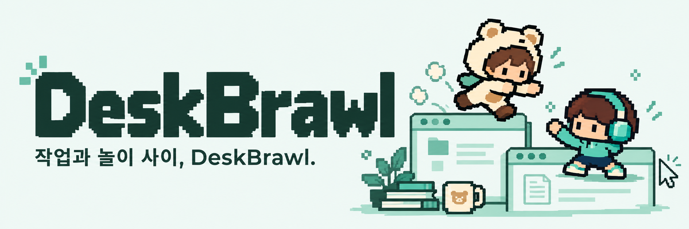

# DeskBrawl

[English](README.md) · **한국어**

DeskBrawl(데스크브롤)은 멀티플레이 데스크톱 펫이에요. 작업 창 위 투명 오버레이에서 픽셀 캐릭터가 돌아다녀요. 잠깐 플레이 모드로 전환해 장난치거나, 방문 링크를 보내 친구와 각자의 데스크톱에서 함께 놀 수 있어요.



## Windows용 다운로드

[GitHub Releases](https://github.com/Jinoko01/deskbrawl/releases)의 **Assets**에서 `DeskBrawl_x64-setup.exe`를 받아 실행하세요. 설치가 끝나면 시작 메뉴에서 **DeskBrawl**을 열어요. Releases에 설치 파일이 아직 없다면 [소스에서 실행](#소스에서-실행)할 수 있어요.

Windows 11의 주 모니터에서 동작을 확인했어요. 앱 화면은 한국어로 표시돼요.

macOS 15 이상을 사용한다면 [Mac에서 소스로 실행하거나 DMG를 빌드](docs/macos-build.md)할 수 있어요. Mac에서는 DeskBrawl 창이 활성화되어 있을 때 플레이 조작키와 전환 단축키를 사용해요.

## 주요 기능

- 픽셀 캐릭터 8종 중 하나를 골라요. 작업 모드에서 클릭은 아래 작업 창으로 전달돼요. Windows에서는 캐릭터를 끌어 옮길 수 있어요.
- 플레이 모드에서 움직이고, 가까이 있는 상대를 공격하거나 돌을 던져요. 공격이 맞으면 상대가 밀려나거나 잠시 기절해요.
- 방문 링크로 호스트 포함 최대 6명이 함께 놀 수 있어요. 각자의 데스크톱에 같은 게임 상태가 표시돼요. 네트워크로는 게임 상태와 채팅을 주고받으며, 데스크톱 화면은 각자의 PC에 그대로 남아요.
- 집중 모드를 켜면 오버레이가 숨겨지고 방문을 쉬어요. 조작키를 바꾸거나 애니메이션 효과를 줄일 수도 있어요.

## 처음 플레이하기

1. DeskBrawl을 열면 주 모니터에 내 캐릭터와 연습 상대가 나타나요. 로컬 플레이는 멀티플레이 서버 없이 할 수 있어요.
2. <kbd>Ctrl</kbd> + <kbd>Shift</kbd> + <kbd>G</kbd>를 눌러 플레이 모드에 들어가세요. 방향키로 움직이고 <kbd>Z</kbd>로 근접 공격, <kbd>X</kbd>로 돌을 던져요. 연습 상대에게 가까이 다가가 공격하면 상대가 밀려나는 모습을 볼 수 있어요.
3. <kbd>Esc</kbd>를 누르면 작업 모드로 돌아와요. 홈 창을 닫아도 오버레이는 계속 떠 있어요. 앱을 종료하려면 트레이나 메뉴 막대에서 **종료**를 선택하세요.

함께 플레이하려면 두 앱을 같은 서버에 연결하세요. 호스트는 **내 공간 연결**을 누르고 **방문 링크 생성**을 선택해요. 방문자는 **친구에게 놀러 가기**에서 받은 링크를 붙여넣고 **방문하기**를 눌러요. 방문이 시작되면 플레이 모드에서 <kbd>/</kbd>를 눌러 채팅을 열 수 있어요.

## 소스에서 실행

### 데스크톱 앱 실행

Windows에 Git, Node.js `>=22.13.0 <23`, pnpm `10.34.7`을 설치하세요. Rust MSVC 툴체인(Rust 1.95 이상), **C++를 사용한 데스크톱 개발** 워크로드와 Windows SDK가 포함된 Visual Studio Build Tools, Microsoft Edge WebView2 Runtime도 필요해요. [Tauri Windows 준비 사항](https://v2.tauri.app/start/prerequisites/#windows)

PowerShell에서 저장소를 복제하고 실행하세요. DeskBrawl 창과 오버레이가 열려요.

```powershell
git clone https://github.com/Jinoko01/deskbrawl.git
cd deskbrawl
pnpm install --frozen-lockfile
pnpm dev
```

### 멀티플레이 서버 실행

로컬에서 서버를 개발하려면 Docker Compose가 포함된 Docker Desktop을 실행하세요. 저장소 루트에서 PowerShell을 하나 더 열어 서버 환경변수 예제 파일을 복사하고 PostgreSQL을 시작하세요.

```powershell
Copy-Item apps/server/.env.example apps/server/.env
docker compose up -d --wait postgres
node -e "console.log(require('node:crypto').randomBytes(32).toString('hex'))"
```

출력된 값을 `apps/server/.env`의 `JWT_SECRET`에 넣으세요. 예제의 나머지 값은 `54329` 포트의 로컬 PostgreSQL과 `3000` 포트의 로컬 서버에 맞춰져 있어요. 같은 터미널에서 마이그레이션을 적용하고 서버를 실행하세요.

```powershell
$env:DATABASE_URL = node --env-file=apps/server/.env -p "process.env.DATABASE_URL"
pnpm --filter @deskbrawl/server db:migrate
pnpm dev:server
```

`http://127.0.0.1:3000/health`에서 `{"ok":true}`가 나오면 서버가 준비된 거예요. 처음 복제한 저장소의 데스크톱 앱은 기본으로 이 서버를 사용해요. 여러 PC에서 접속하려면 모두 접근할 수 있는 서버 주소를 사용하고 각 앱에 그 주소를 설정하세요. [설치 파일 빌드와 서버 설정 (영문)](docs/windows-release.md)

## 저장소 구조

| 경로 | 역할 |
| --- | --- |
| [apps/desktop](apps/desktop) | Tauri, React, PixiJS로 만든 데스크톱 앱과 오버레이 |
| [apps/server](apps/server) | NestJS와 Socket.IO를 사용하는 멀티플레이 서버. 게임 진행과 공격을 판정하고 PostgreSQL과 Prisma로 데이터를 저장해요. |
| [packages/game-core](packages/game-core) | 데스크톱 앱과 서버가 공유하는 게임 규칙 |
| [packages/protocol](packages/protocol) | REST와 Socket.IO에서 공유하는 메시지 스키마 |
| [packages/game-assets](packages/game-assets) | 캐릭터 스프라이트와 시각 효과 |

## 기여하기

버그나 개선 아이디어는 [GitHub Issues](https://github.com/Jinoko01/deskbrawl/issues)에 남겨 주세요. 버그를 신고할 때는 운영체제 버전, DeskBrawl 버전, 재현 순서를 함께 알려 주세요. 코드 변경은 Pull Request로 제안할 수 있어요.

저장소 루트에서 Prisma Client를 생성한 다음 검사와 단위 테스트를 실행하세요.

```powershell
pnpm --filter @deskbrawl/server db:generate
pnpm check
pnpm test
```

Windows 네이티브 검증과 서버 통합 테스트는 [검증 가이드](docs/testing-guide.md)를 참고하세요.

## 라이선스

현재 저장소에 프로젝트 라이선스가 없어요. 코드를 재사용하거나 재배포하려면 먼저 유지관리자에게 허락을 받아 주세요.
