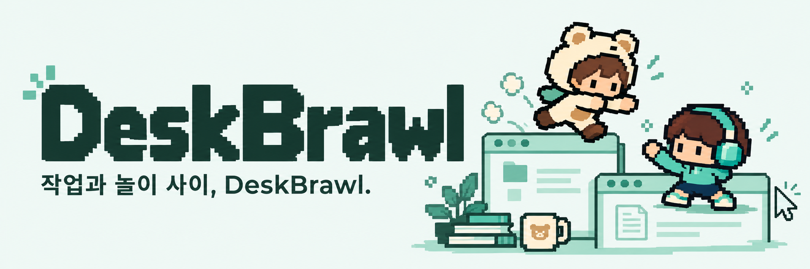

# DeskBrawl

**English** · [한국어](README.ko.md)

DeskBrawl is a multiplayer desktop pet for Windows. Pixel characters roam on a transparent overlay above your apps. Switch to PLAY for a quick brawl, or send an invite link so friends can join you on their own desktops.



## Download for Windows

Open [GitHub Releases](https://github.com/Jinoko01/deskbrawl/releases) and download the `DeskBrawl_*_x64-setup.exe` installer under **Assets**. Run the installer, then open **DeskBrawl** from the Start menu. If the Releases page has no installer yet, you can [run from source](#run-from-source).

DeskBrawl has been tested on the primary monitor in Windows 11. Windows 10, other operating systems, and multi-monitor setups are outside the verified range. The app interface is in Korean.

## What you can do

- Choose from eight pixel characters and drag them around in WORK mode. Clicks outside the characters pass through to the app underneath.
- Move, swing, and throw rocks in PLAY mode. Hits can knock characters back or briefly stun them.
- Share an invite link and play with up to six people, including the host. Everyone sees the same game state on their own desktop. The connection carries game state and chat, while desktop contents stay on each computer.
- Use Focus Mode to hide the overlay and pause visits. You can also remap the game controls and reduce animation effects.

## Play your first game

1. Open DeskBrawl. Your character and a practice opponent appear on the primary monitor. Local play works without a multiplayer server.
2. Press <kbd>Ctrl</kbd> + <kbd>Shift</kbd> + <kbd>G</kbd> to enter PLAY. Use the arrow keys to move, <kbd>Z</kbd> to swing, and <kbd>X</kbd> to throw a rock. Move close to the practice opponent and land a hit to see the knockback.
3. Press <kbd>Esc</kbd> to return to WORK. Minimize the home window to keep the overlay running. Closing the home window exits DeskBrawl.

To play together, connect both apps to the same server. The host selects **내 공간 연결** (Connect my space), then **방문 링크 생성** (Create invite link). The guest pastes the link into **친구에게 놀러 가기** (Visit a friend) and selects **방문하기** (Join). Once connected, switch to PLAY and press <kbd>/</kbd> to open chat.

## Run from source

### Run the desktop app

On Windows, install Git, Node.js `>=22.13.0 <23`, and pnpm `10.34.7`. Install the Rust MSVC toolchain (Rust 1.95 or later), Visual Studio Build Tools with **Desktop development with C++** and a Windows SDK, and Microsoft Edge WebView2 Runtime. [Tauri Windows prerequisites](https://v2.tauri.app/start/prerequisites/#windows)

In PowerShell, clone the repository and start the app. The DeskBrawl window and overlay should open.

```powershell
git clone https://github.com/Jinoko01/deskbrawl.git
cd deskbrawl
pnpm install --frozen-lockfile
pnpm dev
```

### Start a multiplayer server

For local server development, start Docker Desktop with Docker Compose. In a second PowerShell terminal at the repository root, copy the server environment template and start PostgreSQL.

```powershell
Copy-Item apps/server/.env.example apps/server/.env
docker compose up -d --wait postgres
node -e "console.log(require('node:crypto').randomBytes(32).toString('hex'))"
```

Put the generated value in `JWT_SECRET` in `apps/server/.env`. The other template values point to the local PostgreSQL instance on port `54329` and the local server on port `3000`. In the same terminal, apply the migrations and start the server.

```powershell
$env:DATABASE_URL = node --env-file=apps/server/.env -p "process.env.DATABASE_URL"
pnpm --filter @deskbrawl/server db:migrate
pnpm dev:server
```

Check that `http://127.0.0.1:3000/health` returns `{"ok":true}`. The desktop app defaults to that server in a fresh checkout. For clients on other machines, use a server URL they can all reach and configure each app for it. [Installer and server configuration](docs/windows-release.md)

## Repository layout

| Path | Role |
| --- | --- |
| [apps/desktop](apps/desktop) | Windows app and overlay built with Tauri, React, and PixiJS |
| [apps/server](apps/server) | NestJS and Socket.IO server that runs multiplayer sessions and resolves hits, with PostgreSQL and Prisma |
| [packages/game-core](packages/game-core) | Game rules shared by the desktop app and the server |
| [packages/protocol](packages/protocol) | Shared REST and Socket.IO message schemas |
| [packages/game-assets](packages/game-assets) | Character sprites and visual effects |

## Contributing

Use [GitHub Issues](https://github.com/Jinoko01/deskbrawl/issues) to report bugs or suggest improvements. For a bug report, include your Windows version, DeskBrawl version, and steps to reproduce it. Send code changes as pull requests.

From the repository root, generate Prisma Client, then run the checks and unit tests.

```powershell
pnpm --filter @deskbrawl/server db:generate
pnpm check
pnpm test
```

For native Windows and server integration checks, see the [testing guide](docs/testing-guide.md) (Korean).

## License

The repository currently has no project license. Ask the maintainers for permission before reusing or redistributing the project.
