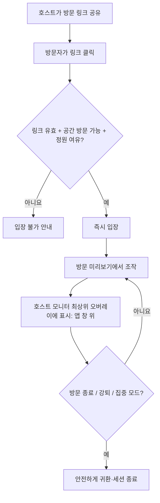

# DeskBrawl 서비스 기획안

> 문서 버전: v1.4 · 작성일: 2026-10-20 · 상태: MVP 범위 정의
>
> 연관 문서: [기능 명세](./DeskBrawl_02_Functional_Spec.md) · [구현 계획](./DeskBrawl_03_Implementation_Plan.md) · [기술 아키텍처](./DeskBrawl_04_Technical_Architecture.md)

## 1. 서비스 개요

**DeskBrawl**은 친구의 **Windows 모니터 전체 공간**에 자신의 픽셀 캐릭터로 방문하여 자유롭게 돌아다니고, 근접 공격이나 돌 던지기로 장난치며 소통하는 **실시간 멀티플레이 데스크톱 펫**이다. 캐릭터는 **모니터 전역의 투명한 최상위 오버레이**에 표시되어 VS Code·브라우저 등 일반 프로그램 창 뒤에 가려지지 않는다. 단, 오버레이는 기본적으로 입력을 통과시켜 작업을 방해하지 않는다.

- **한 줄 소개:** 친구의 **모니터 화면**이 나의 놀이터가 되는 가벼운 멀티플레이 앱.
- **핵심 경험:** 초대 링크 클릭 → 친구의 화면 최상단에 즉시 등장 → 움직이고 장난치기 → 각자의 작업으로 복귀.
- **서비스 성격:** 경쟁·승패·처치가 없는 *비경쟁형 소셜 샌드박스*.
- **초기 플랫폼:** Windows PC 단일 모니터. 캐릭터·돌·이펙트만 투명하게 합성하고 **기존 프로그램 위에서도 캐릭터가 보이도록** 한다. 창 내부에 플러그인으로 삽입하거나 실제 앱 내용을 변경하지 않는다.

## 2. 기획 배경 및 문제

개발자 등 PC 앞에서 장시간 작업하는 사람들은 친구들과 온라인으로 연결되어 있어도 소소한 상호작용을 위해 메신저나 게임을 열어야 한다. 반면 기존 데스크톱 펫은 주로 혼자 감상하거나 자동 반응을 보는 경험에 머무른다.

DeskBrawl은 **친구가 직접 조작하는 캐릭터**를 Windows 모니터 최상단에 띄워, 사용자가 어떤 프로그램을 켜더라도 간단한 장난으로 소통하도록 한다. 대신 투명 오버레이의 클릭·키보드 포커스는 기존 프로그램에 넘겨 작업 흐름을 지킨다.

### 해결하려는 문제

1. 대화나 게임 한 판까지는 부담스러운 순간에 가볍게 소통하기 어렵다.
2. 데스크톱 펫은 다른 사람의 실시간 개입이 적어 상호작용의 재미가 제한된다.
3. 늘 화면 위에 있는 앱은 업무·개발 흐름을 방해하기 쉽다.

### 핵심 가설

- H1: **링크만으로 즉시 입장**할 수 있으면 짧은 방문 경험의 진입 장벽이 낮아진다.
- H2: 공격의 결과가 체력 감소가 아닌 **넉백·짧은 기절**일 때 부담 없는 장난으로 받아들여진다.
- H3: 캐릭터가 작업 창 위에 보이더라도 **클릭 통과·포커스 비획득·이펙트 제한**을 적용하면 작업 중에도 앱을 지속 실행할 수 있다.

> 가설은 검증 대상이며, 현재 사용자 조사나 실측 지표로 입증된 사실은 아니다.

## 3. 타깃 사용자

### 1차 타깃

- 온라인으로 함께 시간을 보내는 개발자, 대학생, 디자이너 등 PC 장시간 사용자.
- Discord 또는 메신저로 수시로 연결되어 있지만 매번 통화·게임을 시작하긴 번거로운 친구 그룹.

### 대표 페르소나

- **A(방문자):** 자신의 PC에서 코딩 중 잠깐 쉬고 싶다. 친구가 공유한 링크를 클릭해 상대의 데스크톱에 나타난다.
- **B(호스트):** VS Code로 개발 중이다. 작은 캐릭터가 VS Code 위에 나타나지만 마우스·키보드 입력을 가로채지 않아 코딩을 계속할 수 있다. 필요할 때 효과를 줄이거나 집중 모드로 숨길 수 있다.

### 대표 시나리오

1. B가 자신의 **방문 링크**를 A에게 공유한다.
2. A가 링크를 클릭하면 별도의 수락/거절 단계 없이 B의 공간으로 입장한다(호스트가 방문 가능 상태인 경우).
3. B의 **모니터 전체를 덮는 투명한 최상위 오버레이**에 A의 캐릭터가 나타난다. VS Code·Chrome 위에서도 캐릭터가 보인다.
4. A는 자신의 **방문 미리보기·조작 창**에서 캐릭터를 움직이고 돌을 던진다.
5. B의 캐릭터가 맞으면 프로그램 위에서 넉백과 짧은 기절 이펙트가 표시된다. **프로그램의 실제 입력과 데이터는 변경되지 않는다.**
6. B는 작업을 계속하거나 플레이 모드로 전환해 A에게 장난을 돌려준다. 시야 방해가 느껴지면 이펙트를 줄이거나 집중 모드로 즉시 숨긴다.
7. A는 귀환하고 B는 작업을 이어 간다.

### 모니터 최상단 표시 정책 (제품 확정)

| 호스트 화면 상황 | DeskBrawl 표시 결과 |
|---|---|
| Windows 바탕화면만 보임 | 캐릭터·돌·이펙트가 투명하게 표시되며 바탕화면 아이콘 클릭은 정상 작동 |
| 일반 창이 일부 열림 | **열린 창 위에** 캐릭터·돌·이펙트 표시; 마우스 입력은 아래 창으로 전달 |
| VS Code·Chrome 최대화 | 최대화된 창 위에도 캐릭터 표시; 키보드 입력은 IDE·브라우저로 전달 |
| Alt+Tab으로 다른 앱 전환 | 오버레이는 보통 계속 표시되고 앱의 포커스 이동을 방해하지 않음 |
| 집중 모드 | 오버레이 숨김, 방문자 퇴장 및 신규 방문 차단 |
| UAC 보안 데스크톱·특수 독점 전체 화면 | 보안/운영체제 제약에 따라 **표시를 보장하지 않으며 우회하지 않음** |

> **‘최상단’은 일반 데스크톱 앱 창보다 위라는 뜻**이다. 운영체제의 보안 화면이나 모든 전용 전체 화면 앱을 강제로 덮겠다는 의미는 아니다. 시각적인 간섭은 캐릭터 크기·효과 강도·집중 모드로 조절한다.

## 4. 핵심 경험 원칙

### P1. 장난이지 전투 경쟁이 아니다

- **근접 공격과 돌 던지기**만으로 상호작용한다.
- 피격 결과는 **넉백 + 일시적 기절**뿐이다.
- 체력, 데미지 수치, 킬, 승패, 죽음, 리스폰, 보상 랭킹을 두지 않는다.
- 캐릭터는 화면 경계에서 멈추거나 튕기며, 공격으로 화면 밖에서 소멸하지 않는다.
- 연속 타격에 따른 불쾌감을 줄이기 위해 짧은 피격 면역 시간을 둔다.

### P2. 링크가 방문 권한이다

- 방 소유자가 발급한 링크를 가진 사람은 **별도 방문 승인 없이 즉시 입장**할 수 있다.
- 방 소유자는 링크 비활성화·재발급, 방문자 강퇴, 집중 모드를 사용할 수 있다.
- 유출된 링크로도 입장할 수 있는 구조이므로 **충분히 긴 난수 토큰**, 속도 제한, 방문 인원 제한, 호스트 통제가 필요하다.
- 링크만으로 입장한다는 것은 *사용자 계정 로그인/수락 화면을 요구하지 않는다*는 의미다. 다만 최초 기기 설치와 닉네임 설정은 필요할 수 있다.

### P3. 모니터 최상단에 보이되 입력은 가로채지 않는다

- 캐릭터·돌·이펙트는 **모니터 전역 투명 `alwaysOnTop` 오버레이**에 렌더링한다. 일반 프로그램 창 위에서도 볼 수 있다.
- **배경은 완전히 투명**하며 캐릭터/이펙트 외에는 그리지 않는다. 프로그램 내용을 수정하거나 키를 대신 입력하지 않는다.
- 오버레이 전체는 **마우스 클릭·드래그·스크롤을 통과**시키고, 포커스를 획득하지 않는다. 사용자는 작업 프로그램을 그대로 조작한다.
- 이동/공격 키는 **DeskBrawl 조작 창에 포커스가 있을 때만** 유효하다. 기본 작업 모드에서는 일반 키를 가로채지 않는다.
- 플레이 전환용 고유 단축키만 전역 등록하고 사용자가 변경할 수 있다.
- 이펙트 강도·가시성 설정을 제공하고, 집중 모드에서 오버레이를 즉시 숨기고 새 방문을 차단한다.
- MVP는 Windows 단일 모니터의 논리적 좌표계를 사용하며 시스템 작업 표시줄 영역은 필요 시 캐릭터 이동 경계에서 제외한다.

### P4. 실제 화면은 공유하지 않는다

- 방문자는 **캐릭터·돌·이펙트·추상적 바닥만 포함한 게임 공간**을 본다.
- 호스트의 코드, 열린 문서, 브라우저 내용, 창 제목, 화면 캡처는 전달하지 않는다.
- 방문자가 제어할 수 있는 것은 자신의 게임 캐릭터뿐이다.

## 5. 핵심 기능 및 우선순위

| 구분 | 기능 | 설명 | 우선순위 |
|---|---|---|---|
| 데스크톱 | 최상위 투명 오버레이 | 일반 앱 **위**, 모니터 전체에 캐릭터·이펙트 표시 | P0 |
| 데스크톱 | 클릭 통과·포커스 비획득·작업 모드 | 모든 일반 앱과 바탕화면 아이콘의 키·마우스 동작 보존 | P0 |
| 조작 | 4방향 이동 | 기본 방향키(↑/←/↓/→), 변경 가능 | P0 |
| 장난 | 근접 공격 | 기본 Z, 피격 시 넉백·기절 | P0 |
| 장난 | 돌 던지기 | 기본 X, 투사체 적중 시 넉백·기절 | P0 |
| 방문 | 링크 즉시 입장 | 호스트가 공유한 링크로 바로 합류 | P0 |
| 방문 | 방문 미리보기 | 화면 공유 없이 친구 공간 조작 | P0 |
| 안정성 | 강퇴·링크 재발급 | 호스트 통제 및 링크 유출 대응 | P0 |
| 안정성 | 집중 모드 | 방문 차단, 기존 방문 세션 정리, 캐릭터 숨김 | P0 |
| 멀티플레이 | 최대 6명 | 호스트 포함 한 공간 동시 접속 | P1 |
| 안정성 | 재연결·동기화 | 일시적인 네트워크 장애 처리 | P1 |
| 커스터마이징 | 캐릭터 스킨·이모트 | 개인화 및 표현력 확대 | P2 |
| 공간 확장 | 모니터 공간 장난 아이템 | 프로그램 위에 투명하게 합성되는 추가 이펙트·오브젝트 | P2 |

> 우선순위: **P0 = MVP 필수**, **P1 = MVP 안정화/확장**, **P2 = 후속 버전**. 첫 검증은 호스트 1명 + 방문자 1명부터 시작한다.

## 6. 주요 화면과 사용자 흐름

| 화면 | 목적 | 구성 요소 |
|---|---|---|
| 홈/트레이 | 앱 상태 확인 | 내 닉네임, 방문 가능 여부, 집중 모드, 링크 복사 |
| 초대 링크 | 친구 방문 연결 | 링크 생성·복사·재발급, 접속 인원 |
| 모니터 오버레이 | 호스트 공간 표시 | **일반 창 위**에서 내·방문자 캐릭터, 돌·타격 애니메이션을 투명하게 표시 |
| 방문 미리보기 | 방문자 조작 | **호스트 화면을 보여주지 않는** 추상적 배경, 참가 캐릭터, 입력 안내, 귀환 |
| 설정 | 간섭 최소화 | 키 매핑, 플레이 단축키, 오버레이 표시·투명도·효과 강도 설정 |

## 7. 범위 및 비범위

### MVP 포함

- Windows 단일 모니터 환경, 트레이 앱, **최상위·투명·클릭 통과 캐릭터 오버레이**.
- 링크 생성·복사·자동 입장, 방문 미리보기.
- 호스트 캐릭터 1명과 방문자 캐릭터 표시.
- 4방향 이동, 근접 공격, 돌 던지기, 넉백, 짧은 기절.
- 작업/플레이/집중 모드, 강퇴·링크 재발급.
- 최소한의 연결 끊김 복구와 오류 안내.

### MVP 제외

- 경쟁·체력·킬·승패·사망·리스폰.
- 화면 공유, 원격 데스크톱 제어, 실제 OS 입력 조작.
- 친구 추천/소셜 피드, 랭킹, 상점, 결제.
- 실제 프로그램 창의 위치·모양을 감지해 발판으로 사용하는 물리 상호작용(단순히 창 **위에 표시**하는 것은 MVP 포함).
- macOS·Linux·멀티 모니터 정식 지원.

## 8. 성공 지표와 검증 방법

| 가설 | 검증 질문 | 초기 측정안(목표치는 사용자 테스트 후 확정) |
|---|---|---|
| 쉬운 진입 | 초대 링크로 막힘 없이 접속하는가? | 링크 클릭→입장 성공률, 입장 완료 시간 |
| 재미 | 공격·피격 반응을 실제로 즐기는가? | 테스트 세션당 장난 상호작용 횟수, 정성 피드백 |
| 비방해 | 작업 중 계속 켜 둘 수 있는가? | 키 입력 충돌, 클릭 차단 사례 수, 사용자 설문 |
| 안정성 | 서로 다른 PC에서 같은 결과가 보이는가? | 위치 불일치, 공격 판정 불일치, 재연결 성공률 |
| 재사용 | 다음 날에도 켜고 싶은가? | 소규모 베타 재방문 의향 및 실행 빈도 |

### 핵심 검증 과제

1. 실제 개발자가 VS Code·Chrome을 실행하면 캐릭터가 **창 위에 표시되면서도** 클릭·스크롤·키보드·포커스 동작에 간섭하지 않는가?
2. 친구를 수락 대기 없이 방문하는 방식이 직관적인가?
3. 넉백·기절만으로도 3~5분 정도 장난치는 재미가 있는가?
4. 방문자가 호스트 화면을 볼 수 없어도 공간을 이해하고 조작할 수 있는가?

## 9. 리스크 및 대응

| 리스크 | 대응 |
|---|---|
| 최상위 투명 오버레이가 클릭·포커스를 가로챔 | 클릭 통과/비활성 PoC 선행; 실패 시 오버레이 즉시 숨기고 작업 보호 |
| 링크 유출로 원치 않는 방문 | 난수 토큰, 링크 폐기·재발급, 인원 제한, 강퇴, 집중 모드 |
| 작업 도중 과도한 피격 애니메이션 | 짧은 기절·면역 시간, 애니메이션 강도 제어, 집중 모드 |
| 방문자가 호스트 화면을 볼 수 없는 혼란 | 공통 게임 좌표·추상 공간·미리보기 제공 |
| 네트워크 지연으로 피격 결과 불일치 | 서버 권위 판정, 스냅샷·보간, 재연결 정책 |
| Windows 투명 합성·전면 표시의 버전별 차이 | Windows 10/11 실기기에서 투명도·DPI·Alt+Tab·최상위 유지 검증 |
| 플랫폼별 창 동작 편차 | 초기 Windows 단일 모니터로 제한, OS별 후속 검증 |

## 10. 추후 검토할 확장 방향

- 시스템 작업 표시줄·실제 앱 조작에 간섭하지 않는 장난 오브젝트·이펙트. 이후 앱 창 경계를 안전하게 인식해 등반하는 기능을 별도 동의 기반으로 검토한다.
- 사용자별 캐릭터 외형, 표정, 이모트.
- 바나나 껍질 등 처치 없는 장난 아이템.
- 작은 그룹용 여러 방문자 동기화 개선.

---

**제품 정의:** DeskBrawl은 '누가 이겼는가'보다 '친구가 내 화면에 와서 무슨 장난을 쳤는가'를 기억하게 만드는 서비스다.

## 11. 고도화된 기술 구현 방향 (v1.4)

이 서비스의 차별화 요소인 **Windows 최상위 투명 오버레이, 키 입력 비방해, 링크 즉시 방문, 서버 권위 장난 판정**에 맞춰 기술을 두 영역으로 분리한다.

- **데스크톱(Tauri 2 중심):** Rust/Win32가 모니터·투명 최상위 창·트레이·딥링크를 담당한다. React + TypeScript + Tailwind/shadcn/ui는 설정·방문 UI, PixiJS는 캐릭터·이펙트 렌더링을 맡는다. Zustand는 클라이언트 UI, TanStack Query는 REST 데이터에만 사용하고 게임 프레임 상태는 PixiJS 버퍼로 관리한다.
- **게임 서버(NestJS 중심):** NestJS REST Controllers와 Socket.IO Gateway를 분리한다. Auth/Rooms/Invites/Visits/Simulation 모듈로 구성하며 이동·돌·피격은 서버 메모리의 게임 루프에서 권위 판정한다. Prisma/PostgreSQL에는 기기·초대 링크·방 정보 등 영속 데이터만 저장한다.
- **공유 코드:** 모노레포의 `protocol`(Zod 이벤트 계약)과 `game-core`(순수 TypeScript 이동/충돌/넉백 규칙)로 클라이언트 예측과 서버 판정의 불일치를 줄인다.
- **초기 단순성:** 1개 NestJS 서버 인스턴스·단일 모니터를 기준으로 검증하고 Redis 및 분산 게임 서버는 사용량이 입증될 때 도입한다.

> 선정 근거, 모듈 설계, API·Gateway 계약, 패키지 구조와 배포 기준은 [기술 스택 및 상세 아키텍처](./DeskBrawl_04_Technical_Architecture.md)를 참고한다.
