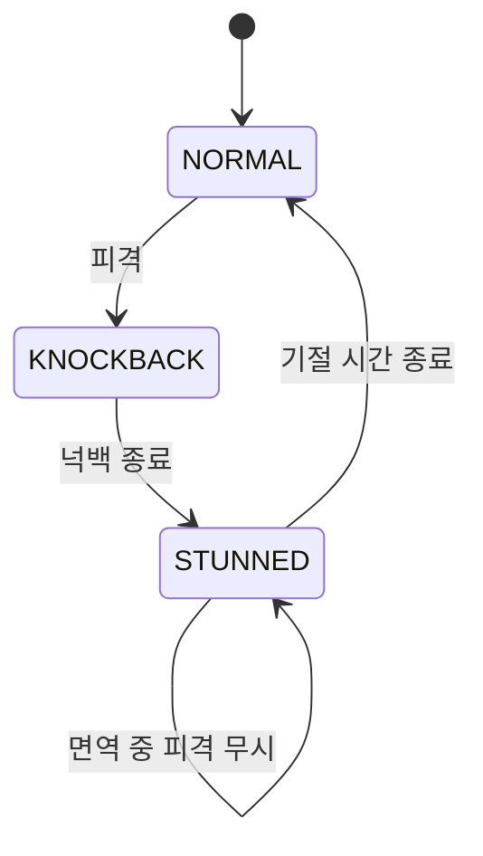
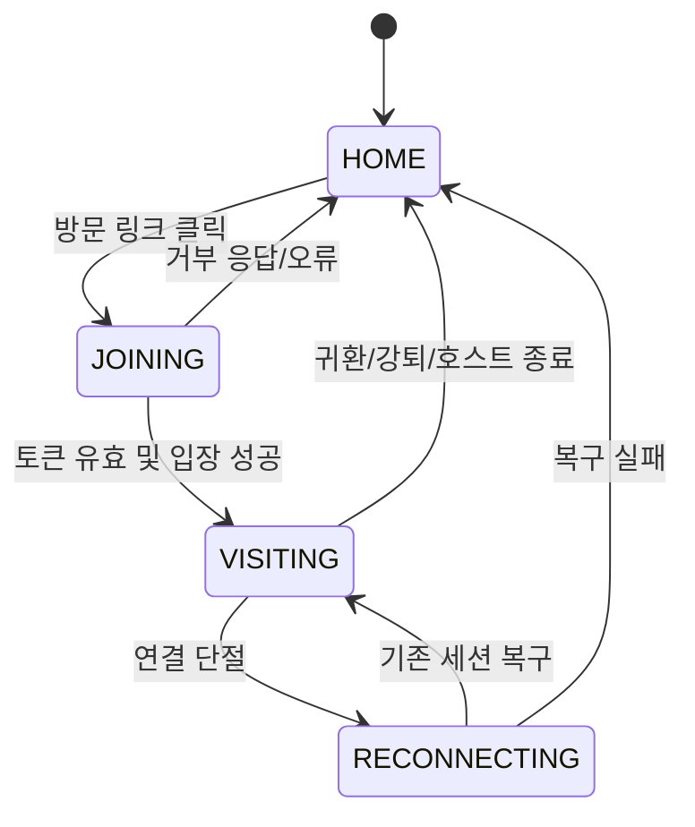

# DeskBrawl 기능 명세서

> 문서 버전: v1.4 · 작성일: 2026-10-20 · 상태: 구현 기준 초안
>
> 연관 문서: [기획안](./DeskBrawl_01_Proposal.md) · [구현 계획](./DeskBrawl_03_Implementation_Plan.md) · [기술 아키텍처](./DeskBrawl_04_Technical_Architecture.md)

## 0. 용어와 명세 규칙

| 용어 | 의미 |
|---|---|
| 호스트(Host) | 자신의 PC 데스크톱 공간을 방문 가능하도록 연 사용자 |
| 방문자(Guest) | 호스트의 링크로 해당 공간에 입장한 사용자 |
| 방문 공간(World) | 호스트 화면에 매핑되는 논리적 2D 게임 영역 |
| 최상위 투명 오버레이(Topmost Overlay) | Windows 모니터 전체를 덮되 배경은 투명하며 **일반 작업 창 위**에서 캐릭터만 그리는 입력 통과 렌더링 창 |
| 방문 미리보기(Visit View) | 방문자가 호스트의 실제 화면 대신 보는 추상 게임 화면 |
| 작업 모드(Work Mode) | 일반 앱 입력을 가로채지 않고 캐릭터만 보여주는 기본 상태 |
| 플레이 모드(Play Mode) | DeskBrawl 조작 창에 포커스를 주고 캐릭터를 조작하는 상태 |
| 집중 모드(Focus Mode) | 최상위 오버레이를 숨기고 현재 방문자를 내보내며 새 입장을 막는 상태 |
| 방문 링크(Invite Link) | 별도 승인 없이 해당 방문 공간으로 입장 가능한 권한 토큰 포함 링크 |
| P0/P1/P2 | MVP 필수 / 안정화 및 규모 확장 / 후속 기능 |

**비기능적 기본 원칙**

1. 캐릭터는 공격으로 제거·사망·리셋되지 않는다. 화면 가장자리에 닿으면 경계 내에서 멈추거나 반사된다.
2. 공격 결과는 **넉백과 일시적 기절**로 제한한다. HP, 데미지, 승패, 처치 통계가 없다.
3. 방문 링크가 유효하면 별도 수락/거절 없이 입장한다. 단, 호스트가 방문을 닫았거나 정원이 가득 찬 경우에는 거절 응답을 준다.
4. 일반 이동·공격 키는 DeskBrawl 조작 창에 포커스가 있을 때만 게임 입력으로 해석한다. 최상위 오버레이는 포커스를 획득하지 않는다.
5. 캐릭터는 **Windows 모니터 최상위 투명 오버레이**에 표시되어 일반 프로그램 창 위에서도 보인다. 호스트의 실제 데스크톱 화면·창 제목·파일명·키보드 입력·클립보드는 네트워크로 전송하지 않는다. 운영체제 보안 화면 등은 최상위 표시의 예외로 둔다.

## 1. 화면/컴포넌트 정의

| ID | 화면 | 주 사용자 | 주요 구성 |
|---|---|---|---|
| UI-01 | 홈/트레이 | 전원 | 내 닉네임, 상태, 링크 복사, 집중 모드, 설정 |
| UI-02 | 방문 링크 관리 | 호스트 | 링크 표시·복사·재발급·방문 가능 상태·접속 인원 |
| UI-03 | 모니터 최상위 오버레이 | 호스트 | 일반 창 위에서도 호스트·방문자 캐릭터, 돌, 넉백/기절 표시; 클릭 통과·포커스 비획득 |
| UI-04 | 방문 미리보기 | 방문자 | 추상 배경, 캐릭터·투사체, 조작 안내, 귀환 |
| UI-05 | 설정 | 전원 | 조작키 변경, 전환 단축키, 최상위 오버레이 표시/투명도/효과 강도 |
| UI-06 | 연결/오류 안내 | 전원 | 연결 중, 링크 만료, 공간 닫힘, 정원 초과, 복구 실패 |

## 2. 기능 요구사항

### FR-001. 앱 실행 및 시스템 트레이 — P0

**설명:** 앱 실행 시 작업 흐름을 유지할 수 있도록 백그라운드 상주 형태로 동작한다.

**동작**
- 첫 실행 시 로컬 닉네임을 설정한다. MVP에는 별도 회원가입을 요구하지 않는다.
- 앱을 실행하면 자신의 방문 공간을 서버에 등록하고 모니터 최상위 투명 오버레이의 캐릭터 표시를 시작한다.
- 앱의 설정 창을 닫아도 트레이에서 동작하며, 명시적 `앱 종료` 선택 시 연결을 종료한다.
- 트레이에는 `홈 열기`, `링크 복사`, `집중 모드 켜기/끄기`, `앱 종료`를 제공한다.

**인수 조건**
- [ ] 메인 창을 닫아도 앱과 방문 공간이 유지된다.
- [ ] 앱 완전 종료 시 서버가 해당 공간의 비활성 상태를 감지한다.
- [ ] 브라우저나 VS Code 사용 중 예기치 않은 창 포커스 이동이 발생하지 않는다.

### FR-002. Windows 모니터 최상위 투명 오버레이 — P0

**설명:** 모니터의 투명한 최상위 레이어에 캐릭터·돌·이펙트만 렌더링한다. VS Code·Chrome·탐색기 등의 일반 프로그램 창 위에도 표시되며, 마우스·키보드·포커스는 기존 프로그램이 계속 사용한다.

**동작**
- **Windows 주 모니터 전체**에 대응하는 별도 Tauri `overlay` 창을 생성한다. MVP는 단일 모니터를 대상으로 하고, 게임 물체 이동 경계는 작업 표시줄을 피하도록 별도 설정할 수 있다.
- 창은 `transparent: true`, `decorations: false`, `alwaysOnTop: true`, `skipTaskbar: true`, `focus: false`, `shadow: false` 등으로 구성하고 크기·위치를 모니터에 맞춘다. 배경의 알파 값은 0으로 유지하고 캐릭터·투사체·이펙트만 렌더링한다.
- **`setIgnoreCursorEvents(true)`로 전체 오버레이의 마우스 이벤트를 통과**시키며 클릭·드래그·우클릭·휠 동작이 아래 앱에 전달되어야 한다. 오버레이는 키보드 포커스를 획득하지 않는다.
- 오버레이에서 직접 캐릭터를 클릭하거나 드래그하는 기능은 MVP에서 제공하지 않는다. 메뉴/컨트롤은 별도 일반 창이나 시스템 트레이로 분리한다.
- `WORK` 모드에서는 일반 키보드 입력을 전역 수신하지 않고 `PLAY`에서만 조작 창이 입력을 받는다. 기본 전역 단축키는 모드 전환 용도 하나만 등록한다.
- 프로그램 창을 이동·최대화하거나 Alt+Tab으로 전환해도 캐릭터는 일반적인 데스크톱 창 위에 **계속 표시**된다. 창에 표시된 실제 코드·문서·영상 내용은 변경하지 않는다.
- 해상도·배율·모니터 변경 시 오버레이의 크기와 좌표 변환을 갱신한다. 렌더 실패·클릭 차단·의도치 않은 포커스 획득이 감지되면 즉시 숨기고 트레이에서 복구할 수 있도록 한다.
- Windows 보안 데스크톱(UAC 보안 프롬프트, 잠금 화면), 일부 독점 전체 화면 프로그램, 다른 최상위 창과의 순서 경쟁은 운영체제 제약이므로 표시를 보장하지 않는다. 보안 화면 우회는 구현하지 않는다.

**인수 조건**
- [ ] VS Code·Chrome 최대화/복원 중에도 캐릭터·돌·이펙트가 **창 위에** 표시된다.
- [ ] VS Code의 텍스트 입력·자동완성·선택, Chrome 클릭·스크롤·탭 전환이 캐릭터 영역을 통과해 정상 동작한다.
- [ ] Alt+Tab·작업 표시줄 조작 시 오버레이로 포커스가 이동하지 않고 작업 대상이 유지된다.
- [ ] 투명 배경으로 바탕화면·창 내용이 왜곡 없이 보이며 검정/흰색 사각형이 남지 않는다.
- [ ] 게임 오브젝트가 모니터 경계를 넘어서 소멸하지 않으며 DPI/해상도 변경 후에도 좌표가 맞는다.
- [ ] 렌더 오류 시 오버레이를 안전하게 숨기고, 종료·집중 모드에서도 입력을 가로채지 않는다.
- [ ] 잠금 화면·UAC 등 보안 영역을 가리려고 시도하지 않는다.

### FR-003. 작업·플레이·집중 모드 — P0

| 상태 | 최상위 오버레이 | 게임 조작 | 새 방문 | 기존 방문 |
|---|---|---|---|---|
| `WORK` | 보임 | 비활성(로컬 캐릭터 자동 대기) | 허용 | 유지 |
| `PLAY` | 보임 | 조작 창 포커스에서 활성 | 허용 | 유지 |
| `FOCUS` | 숨김 | 비활성 | 차단 | 종료·귀환 안내 |

**동작**
- 기본 모드는 `WORK`이다.
- 기본 `Ctrl+Shift+F12` 단축키 또는 트레이 메뉴로 `PLAY` 전환을 시도한다. 단축키는 설정에서 변경할 수 있다.
- `PLAY` 진입 시 별도의 조작/미리보기 창에 포커스를 준다. 캐릭터 렌더링 오버레이는 계속 **일반 앱 위에 표시**되지만 키보드 포커스는 조작 창만 갖는다.
- `Esc` 또는 전환 단축키로 `WORK`로 복귀하고, 가능하면 원래 작업 창의 포커스를 복원한다.
- `FOCUS` 진입 시 현재 방문자를 안전하게 퇴장시키고 링크 입장을 막는다. 해제해도 링크 자체는 유지된다.
- 호스트가 작업 중에도 타인이 호스트의 캐릭터를 타격할 수 있으며 **현재 열린 작업 창 위에서 넉백·기절 애니메이션이 보인다.** 다만 OS/앱 입력은 변경하지 않는다. 시각적 간섭은 효과 축소·집중 모드로 제어한다.

**인수 조건**
- [ ] `WORK`에서 I/J/K/L/U/O 입력이 작업 프로그램에 정상 전달된다.
- [ ] `PLAY`에서만 해당 입력이 캐릭터 조작으로 작동한다.
- [ ] `FOCUS`에서는 방문 요청 없이 링크 접속 시 `ROOM_UNAVAILABLE`이 반환된다.
- [ ] `FOCUS` 전환 직후 기존 방문자 화면에 종료 안내가 표시된다.
- [ ] `WORK`/`PLAY` 모두 일반 작업 창 위에 캐릭터가 보이지만 클릭·키보드 입력은 방해하지 않는다.

### FR-004. 조작키 및 키 매핑 — P0

**기본 프리셋**

| 입력 | 키 | 동작 |
|---|---|---|
| 위 | I | -Y 이동 |
| 왼쪽 | J | -X 이동 |
| 아래 | K | +Y 이동 |
| 오른쪽 | L | +X 이동 |
| 근접 공격 | U | 마지막 바라본 방향으로 공격 |
| 돌 던지기 | O | 마지막 바라본 방향으로 돌 발사 |
| 플레이 전환 | Ctrl+Shift+F12 | 작업 ↔ 플레이 |
| 플레이 종료 | Esc | 플레이 → 작업 |

**동작**
- 일반 조작키는 OS 전역 훅으로 등록하지 않는다.
- 이동키 2개 동시 입력 시 대각선 이동은 정규화하여 직선 이동보다 빨라지지 않도록 한다.
- 가만히 서 있다가 공격할 경우 마지막 이동 방향을 사용한다.
- 사용자는 게임 조작키와 전환 단축키를 변경할 수 있다. 키 중복 및 예약 단축키 충돌을 안내한다.
- 보조 프리셋(선택): Num 8/4/2/6 이동, Num 7/9 공격/투척.

**인수 조건**
- [ ] 이동키 입력을 유지하면 자연스럽게 이동하고 손을 떼면 정지한다.
- [ ] `PLAY` 창이 포커스를 잃으면 즉시 이동·공격 입력을 해제한다(키 눌림 잔류 방지).
- [ ] 게임 중 키 중복 등록이 불가능하며 변경 후 재실행해도 설정이 유지된다.

### FR-005. 방문 링크 생성·관리 — P0

**동작**
- 호스트는 서버가 발행한 충분히 긴 랜덤 토큰을 포함하는 공유 링크를 제공받는다.
- 예시 형식(가상 도메인): `https://deskbrawl.example/join/<token>`.
- 설치된 앱에서는 브라우저 링크를 사용자 지정 URI(`deskbrawl://join/<token>`)로 넘기거나 앱 연결을 통해 방문한다. 미설치 상태에서는 설치 안내가 먼저 표시된다.
- 호스트는 링크를 복사, 폐기/재발급할 수 있다. 링크 재발급 즉시 **이전 링크는 새 입장에 사용할 수 없다**.
- 이미 접속 중인 방문자는 링크 재발급만으로 자동 강퇴되지 않는다. 필요하면 `모두 내보내기` 또는 개별 강퇴를 사용한다.
- 링크를 가진 누구나 승인 없이 입장할 수 있으므로 관리 화면에 주의를 표시한다.

**인수 조건**
- [ ] 유효한 링크로 즉시 방문에 성공한다(별도 방문 수락 팝업 없음).
- [ ] 폐기된 링크는 새 방문에 실패한다.
- [ ] 링크는 추측하기 어렵고 서버 로그에 평문 토큰이 기록되지 않는다.
- [ ] 중복 클릭·중복 요청으로 동일 사용자가 여러 캐릭터로 입장하지 않는다.

### FR-006. 즉시 방문·귀환 — P0

**사전 조건:** 클라이언트 설치, 호스트 공간 활성, 유효한 링크, 정원 여유, 접속 제한에 해당하지 않음.

**동작**
1. 방문자가 링크를 클릭한다.
2. 앱이 토큰을 서버에 전달하고 서버가 검사한다.
3. 서버가 방문 세션을 생성하고 `visit:joined`를 반환한다.
4. 호스트의 모니터 최상위 오버레이에 방문자 캐릭터가 등장한다. 기존 앱 창 위에서도 가려지지 않고 보인다.
5. 방문자는 추상적 미리보기에서 캐릭터를 조작한다.
6. 방문 종료 시 서버가 세션을 정리하고 호스트에게 퇴장을 알린다.

**제약**
- 한 사용자(기기)는 동시에 하나의 외부 방문 세션만 가진다.
- 기본 정원은 **호스트 포함 총 4명**으로 잡는다(P1 최종 확장). P0 검증은 호스트+방문자 2인.
- 호스트 자신의 방문 공간에 중복 입장하는 것은 방지한다.
- 닉네임은 인증 수단이 아니며 방문 세션/소켓은 서버 측 식별자로 구분한다.

**인수 조건**
- [ ] 호스트가 미리 승인하지 않아도 정상적인 방문을 시작할 수 있다.
- [ ] 동일한 링크를 연속해서 눌러도 방문자 캐릭터가 중복 생성되지 않는다.
- [ ] 방문 종료 시 호스트 화면의 방문자 캐릭터가 제거된다(공격에 의한 소멸과 무관한 정상 퇴장).

### FR-007. 방문 미리보기 — P0

**설명:** 방문자는 호스트의 화면 캡처 없이 동일한 게임 상태를 관찰한다.

**동작**
- 미리보기에는 닉네임·캐릭터·돌·공격/피격 애니메이션·추상 배경을 렌더링한다.
- 호스트 화면과 동일한 논리 좌표를 미리보기 크기에 맞춰 종횡비를 유지한 채 변환한다.
- 호스트의 앱/창 제목, 파일 내용, 바탕화면 배경 이미지는 나타나지 않는다.
- 호스트에게 실제로 보이는 영역과 무관하게 방문자는 추상 미리보기에서 게임 상태를 계속 확인한다.
- 미리보기 화면에 `귀환` 버튼과 조작 가이드를 제공한다.

**인수 조건**
- [ ] 호스트의 코드·웹페이지·바탕화면 이미지가 방문자에게 노출되지 않는다.
- [ ] 호스트 화면의 캐릭터 상대적 위치와 방문자 미리보기의 상대적 위치가 일치한다.
- [ ] 미리보기 크기를 조정해도 캐릭터가 찌그러지지 않는다.

### FR-008. 이동 및 화면 경계 — P0

**동작**
- 서버는 현재 입력과 이동 속도, 게임 영역 크기를 기준으로 좌표를 갱신한다.
- 이동은 4방향 및 대각선 입력을 지원하는 *탑다운 방식*으로 시작한다.
- 캐릭터의 충돌 영역이 화면 경계 안에 남도록 좌표를 제한한다.
- 넉백으로 경계에 닿으면 멈추거나 일부 반사되도록 처리한다. **캐릭터는 화면 밖에서 삭제되지 않는다.**
- 서로 다른 모니터 해상도에서도 서버는 호스트 기준의 논리 좌표를 사용한다.

**인수 조건**
- [ ] 캐릭터가 이동이나 넉백 때문에 화면 밖으로 사라지지 않는다.
- [ ] 대각선 이동 속도가 직선 이동 속도보다 높지 않다.
- [ ] 위치가 다른 두 클라이언트에 유사하게 표시되며 지연 후 수렴한다.

### FR-009. 근접 공격 — P0

**동작**
- `U`를 누르면 캐릭터의 전방에 짧은 공격 판정이 발생한다.
- 서버가 거리, 방향, 쿨다운, 기절 상태를 확인한다.
- 명중한 대상은 공격 반대 방향으로 넉백되고 일정 시간 기절한다.
- 공격 자체로 생명력 감소·추가 점수·사망·승패 변화가 발생하지 않는다.
- 공격 대상이 없으면 타격 애니메이션만 실행한다.

**초기 조정값(제안; 테스트 후 확정):** 공격 쿨다운 0.6초, 기절 0.4초, 피격 면역 0.5초.

**인수 조건**
- [ ] 사거리 밖 상대를 공격해도 피격되지 않는다.
- [ ] 기절 중 추가 공격 입력이 실행되지 않는다.
- [ ] 공격 반복으로 대상이 무한 기절 상태에 빠지지 않는다.

### FR-010. 돌 던지기 — P0

**동작**
- `O`를 누르면 캐릭터가 바라보는 방향으로 돌을 던진다.
- 서버가 돌의 위치·속도·충돌을 계산하고, 캐릭터에 맞으면 근접 공격과 동일하게 **넉백·기절**을 적용한다.
- 돌은 캐릭터를 죽이거나 제거하지 않는다.
- 돌이 경계에 닿으면 바닥에 떨어지거나 튕기는 짧은 시각적 연출을 표시한다. 이후 투사체 객체는 렌더링·메모리 관리를 위해 정리할 수 있다. 이 처리는 **캐릭터 소멸과 무관**하다.

**초기 조정값(제안; 테스트 후 확정):** 투척 쿨다운 0.9초, 최대 비행 시간 1.5초.

**인수 조건**
- [ ] 돌을 맞은 캐릭터는 넉백·기절만 발생한다.
- [ ] 발사자가 클라이언트에서 임의로 적중 대상을 지정할 수 없다.
- [ ] 돌의 종료 상태가 모든 클라이언트에서 일관되게 처리된다.

### FR-011. 피격·넉백·기절 — P0

**상태 모델**



**동작**
- 서버는 피격 시 `knockbackVelocity`, `stunnedUntil`, `invulnerableUntil`을 설정한다.
- 클라이언트는 넉백 이동을 보간하고 짧은 기절 포즈를 보여준다.
- 기절 타이머가 끝나면 정상 이동을 회복한다.
- 공격의 결과로 HP, 사망, 강제 퇴장, 리스폰이 발생하지 않는다.

**인수 조건**
- [ ] 기절이 끝나면 조작 가능 상태로 반드시 복귀한다.
- [ ] 기절 도중 세션이 끊겨도 다음 접속에 오래된 기절 상태가 영구 잔류하지 않는다.
- [ ] 피격 방향과 넉백 방향이 자연스럽다.

### FR-012. 실시간 상태 동기화 — P0

**동작**
- 모든 입력·공격 명령은 `visitId`와 시퀀스/명령 ID를 포함한다.
- 게임 상태의 최종 권위는 서버가 갖는다. 클라이언트는 검증되지 않은 좌표·피격 결과를 확정하지 않는다.
- 클라이언트는 자신 캐릭터 이동의 즉각적 반응을 위해 로컬 예측을 적용할 수 있다.
- 다른 캐릭터는 스냅샷 사이의 보간으로 그린다.
- 새로운 세션이 시작되면 이전 세션의 지연 이벤트를 폐기한다.

**초기 목표값(고정 스펙 아님):** 서버 20 tick/s, 스냅샷 10~20회/s, 렌더링 최대 60 FPS.

**인수 조건**
- [ ] 두 PC에서 동일한 근접/돌 적중 결과가 표시된다.
- [ ] 늦게 도착한 예전 스냅샷이 최신 위치를 덮어쓰지 않는다.
- [ ] 네트워크 지연으로 잘못 예측된 로컬 좌표가 점진적으로 보정된다.

### FR-013. 방문자 강퇴 및 링크 차단 — P0

**동작**
- 호스트는 현재 접속자 목록에서 특정 방문자를 즉시 퇴장시킬 수 있다.
- 서버가 강퇴 권한을 검증한다. 클라이언트에서 보낸 `hostId`만으로 호스트 권한을 인정하지 않는다.
- 강퇴된 방문자에게 종료 이유를 보여주고 조작 입력을 정지한다.
- 호스트가 링크를 재발급해도 현재 방문자는 별도 조치 전까지 유지된다.
- 호스트는 `모두 내보내기`를 사용할 수 있다.

**인수 조건**
- [ ] 일반 방문자는 다른 방문자를 강퇴할 수 없다.
- [ ] 강퇴 후 기존 방문 세션을 사용한 게임 명령은 서버에서 거부된다.
- [ ] 강퇴된 클라이언트의 방문 미리보기가 안전하게 종료된다.

### FR-014. 연결 끊김 및 복구 — P1 (기본 오류 대응은 P0)

**동작**
- 연결이 끊기면 입력 전송을 멈추고 `재연결 중`을 표시한다.
- 짧은 단절에 대해서는 서버가 유효한 세션 복구 토큰을 검증한 경우에만 동일 세션으로 재합류시킨다.
- 복구 실패·호스트 종료·링크 폐기 이후 새 입장이 필요한 경우 적절한 안내를 표시한다.
- 복구 직후 서버의 최신 전체 스냅샷을 수신해 상태를 재정렬한다.

**인수 조건**
- [ ] 끊김 후 조작키가 눌린 상태로 고착되지 않는다.
- [ ] 재접속 후 유령 캐릭터나 중복 캐릭터가 남지 않는다.
- [ ] 과거 세션의 공격 이벤트가 새 세션에 영향을 주지 않는다.

### FR-015. 최대 4명 동시 참여 — P1

- 한 방문 공간의 동시 참가자는 **호스트 1명 + 방문자 최대 3명**이다.
- 정원 초과 시 `ROOM_FULL` 안내를 표시한다.
- 참가자 합류·퇴장이 모든 화면에 반영된다.
- 서버는 각 참가자의 입력 빈도를 독립적으로 제한한다.

## 3. 오류 상태 및 안내 문구

| 코드 | 발생 상황 | 사용자 안내 | 후속 행동 |
|---|---|---|---|
| `INVALID_INVITE` | 잘못되거나 폐기된 링크 | 유효하지 않은 방문 링크예요. | 새 링크 요청 |
| `ROOM_UNAVAILABLE` | 호스트 오프라인/집중 모드 | 지금은 이 컴퓨터에 방문할 수 없어요. | 나중에 재시도 |
| `ROOM_FULL` | 정원 초과 | 현재 방문 인원이 가득 찼어요. | 나중에 재시도 |
| `SELF_VISIT` | 자기 공간에 중복 방문 | 자신의 공간에는 방문할 수 없어요. | 홈으로 돌아가기 |
| `ALREADY_VISITING` | 이미 다른 공간 방문 중 | 먼저 현재 방문을 종료해 주세요. | 귀환 |
| `KICKED` | 호스트가 내보냄 | 호스트가 방문을 종료했어요. | 홈으로 돌아가기 |
| `CONNECTION_LOST` | 네트워크 연결 실패 | 연결이 끊어졌어요. 다시 연결하고 있어요. | 재시도/홈 |
| `HOST_LEFT` | 호스트 앱 종료 | 호스트의 공간이 종료되었어요. | 홈으로 돌아가기 |

## 4. 서버 이벤트 계약(초안)

이 계약은 `packages/protocol`의 TypeScript 타입과 Zod 런타임 스키마를 통해 클라이언트·서버에 공유한다.

| 이벤트 | 방향 | 주요 필드 | 응답/비고 |
|---|---|---|---|
| `visit:join` | C→S | `{ token, clientInstanceId, requestId }` | ack: `visitId`, `playerId`, 최초 snapshot 또는 오류 |
| `visit:joined` | S→Room | `{ visitId, player }` | 참가 이벤트 |
| `visit:leave` | C→S | `{ visitId }` | ack, 멱등 |
| `visit:kick` | Host→S | `{ visitId, targetPlayerId }` | 호스트 권한 검증 |
| `visit:link:rotate` | Host→S | `{ roomId }` | ack: 새 링크; 기존 링크 즉시 무효 |
| `player:input` | C→S | `{ visitId, seq, up, down, left, right }` | 고빈도 입력; 오래된 seq 무시 |
| `player:action` | C→S | `{ visitId, actionId, type }` | `melee`, `stone`; actionId로 중복 제거 |
| `world:snapshot` | S→Room | `{ visitId, tick, players, projectiles }` | 비교적 고빈도 상태 |
| `combat:hit` | S→Room | `{ visitId, tick, sourceId, targetId, kind, impulse }` | 장난 결과 확정, 반복 방지 |
| `room:closed` | S→Room | `{ roomId, reason }` | 호스트 종료/집중 모드 |

**입력 샘플**

```ts
interface PlayerInput {
  visitId: string;
  seq: number;
  up: boolean;
  down: boolean;
  left: boolean;
  right: boolean;
}

interface PlayerAction {
  visitId: string;
  actionId: string;
  type: "melee" | "stone";
}

interface PlayerState {
  id: string;
  nickname: string;
  characterId: string;
  x: number;
  y: number;
  vx: number;
  vy: number;
  facing: "up" | "down" | "left" | "right";
  stunnedUntilTick: number;
  invulnerableUntilTick: number;
}
```

**전송 정책**

- `player:input` 및 주기 스냅샷은 최신 상태가 중요하므로 누락 가능한 갱신 방식과 시퀀스 검사를 검토한다.
- `visit:join`, `visit:kick`, `player:action` 등 결과가 중요한 명령에는 ack·타임아웃·중복 제거를 적용한다.
- Socket.IO의 메시지 순서 보장은 연결 장애 후 누락 메시지의 재전송을 의미하지 않으므로 재접속 시 전체 스냅샷으로 복구한다.

## 5. 상태 전이와 예외 흐름

### 방문 상태



### 반드시 방지해야 하는 경합 상황

1. 방문 링크를 더블클릭했을 때 같은 사용자가 2번 생성되는 상황.
2. 연결이 끊긴 방문자의 이전 소켓에서 늦게 도착한 공격 명령이 새 세션에 적용되는 상황.
3. `PLAY`에서 `WORK`로 돌아갔는데 이동키 `keydown` 상태가 남는 상황.
4. 동시에 돌에 맞고 경계에 닿아 좌표가 음수 또는 화면 밖으로 기록되는 상황.
5. 호스트가 집중 모드에 들어가는 순간 방문자가 입장하여 유령 캐릭터가 남는 상황.
6. 링크 재발급 직후 과거 링크로 입장을 요청하는 상황.

## 6. 비기능 요구사항 및 품질 기준

| ID | 분류 | 요구사항 | 확인 방법 |
|---|---|---|---|
| NFR-01 | 프라이버시 | 화면 캡처·창 제목·문서 내용·클립보드 전송 금지 | 패킷/로그 검사 |
| NFR-02 | 사용성 | 작업 모드에서 일반 키·마우스 간섭 0건 목표 | VS Code·Chrome 수동/E2E 시나리오 |
| NFR-03 | 성능 | 유휴/작업 중 불필요한 렌더링 줄이기 | CPU/GPU 프로파일링 |
| NFR-04 | 안정성 | 연결 단절·중복 입력·호스트 종료 후 세션 정리 | 네트워크 장애 주입 테스트 |
| NFR-05 | 보안 | 토큰 추측 방지, 재발급, 권한 확인, 속도 제한 | 보안 테스트 |
| NFR-06 | 일관성 | 피격 판정 결과가 참여자 간 동일 | 2~4 클라이언트 통합 테스트 |
| NFR-07 | 호환성 | Windows 10/11 주 모니터에서 투명 최상위 합성·DPI·입력 통과 검증 | Windows 실기기 매트릭스 |
| NFR-08 | 접근성 | 단축키 재설정·이펙트 감소·집중 모드 | 설정 및 UX 테스트 |

**성능 수치는 구현 전에 약속하지 않는다.** 초기 엔지니어링 목표는 서버 20 TPS, 스냅샷 10~20 Hz, 활성 렌더링 최대 60 FPS이고, 작업 모드에는 별도의 렌더링 제한을 적용한 뒤 측정한다.

## 7. MVP 인수 테스트 시나리오

| 테스트 ID | 시나리오 | 기대 결과 |
|---|---|---|
| AT-01 | 호스트가 VS Code에서 I/J/K/L/U/O 입력 | 에디터에 정상 반영되고 캐릭터는 움직이지 않음 |
| AT-02 | 캐릭터가 표시된 Chrome 창 영역을 클릭·스크롤 | 캐릭터는 Chrome **위에 보이고**, 클릭/휠은 Chrome에만 전달됨 |
| AT-03 | A가 유효한 방문 링크 클릭 | 별도 승인 없이 B 공간에 입장 |
| AT-04 | A가 만료·폐기된 링크 클릭 | 실패 안내, 캐릭터 생성 없음 |
| AT-05 | A가 B에게 근접 공격 적중 | 양쪽에서 같은 넉백·기절 관찰, HP 변화 없음 |
| AT-06 | A가 B에게 돌 적중 | 같은 피격 결과, 캐릭터 사망·소멸 없음 |
| AT-07 | 경계 쪽으로 캐릭터를 지속 이동/넉백 | 캐릭터가 화면 내부에 남음 |
| AT-08 | B가 집중 모드 진입 | 방문자 퇴장, 새 링크 입장 차단, 최상위 오버레이 숨김 |
| AT-09 | B가 링크 재발급 | 이전 링크 신규 접속 실패, 새 링크 접속 성공 |
| AT-10 | 방문 중 A가 연결 끊김 후 복구 | 입력 고착·중복 캐릭터·지연 공격 없음 |
| AT-11 | 두 사용자의 모니터 해상도가 다름 | 상대적 캐릭터 위치 일치, 비율 왜곡 없음 |
| AT-12 | B가 방문자 강퇴 | 해당 방문만 종료, 공격 입력 추가 처리 없음 |
| AT-13 | B가 창을 최대화하고 A가 B에게 돌을 던짐 | 작업 창 **위에** 돌·넉백·기절이 보이지만 창 내용·입력은 변경되지 않음 |
| AT-14 | B가 앱 창을 최소화·복원 또는 Alt+Tab으로 전환 | 캐릭터가 일반 앱 창 위에서 지속 표시되고 포커스는 아래 앱에 유지됨 |
| AT-15 | 디스플레이 배율·해상도 변경 또는 Explorer 재시작 | 오버레이 좌표·크기 갱신 또는 안전 숨김; 일반 앱과 마우스 동작 유지 |
| AT-16 | 바탕화면 아이콘 클릭·드래그 | DeskBrawl이 아이콘 선택·드래그를 가로채지 않음 |

## 8. 미확정 항목(실험으로 결정)

- 기본 캐릭터 속도, 근접 사거리, 넉백 거리, 돌 속도, 기절·면역 시간.
- 최상위 오버레이의 작업 모드 프레임레이트·시각 효과 강도·비활성 상태 저전력 처리.
- 브라우저 링크를 데스크톱 앱으로 연결하는 설치/온보딩 UX.
- 방문 미리보기의 기본 창 크기 및 자동 배치.
- 호스트 캐릭터가 작업 모드일 때의 자동 대기 애니메이션 종류.
- 멀티 모니터 지원 범위(P2), Windows 10/11 빌드별 투명 최상위 창·클릭 통과 호환성.
- 다른 최상위 창과 순서 충돌 시 표시 우선순위, 게임 실행·보안 데스크톱의 예외 정책.

---

**판단 기준:** 캐릭터는 일반 작업 창 **위에 보여야** 한다. 단, **기존 앱의 클릭·스크롤·키보드·포커스를 방해하면 명세 위반**이며 이 경우 오버레이를 숨기고 문제 해결 전에는 출시하지 않는다.


## 9. Tauri·NestJS 기능 구현 매핑 (v1.4)

다음 표는 기존 FR의 **책임 구현 주체**를 확정한다. 기능의 사용자 관찰 동작은 v1.3과 동일하다.

| FR | 프론트엔드 책임 | 백엔드 책임 |
|---|---|---|
| FR-001/002 | Tauri Rust Tray/WindowManager, PixiJS overlay | 연결 상태 유지 |
| FR-003/004 | Tauri Global Shortcut, React controller, Zustand, focus-safe 입력 | 참가자별 입력 사용 가능 상태 검증 |
| FR-005 | React 초대 UI, TanStack Query, deep-link | Nest InvitesController/Service, Prisma token hash·회전 |
| FR-006/007 | Tauri Deep Link + Single Instance, Visit UI/PixiJS | Nest VisitsGateway, Rooms/SessionService |
| FR-008~011 | PixiJS 애니메이션·클라이언트 예측, `game-core` | Nest SimulationEngine + `game-core` 권위 판정 |
| FR-012/014 | socket.io-client, world buffer, 보간·재접속 | Nest Gateway, Room, tick, 전체 snapshot |
| FR-013/015 | React 호스트 제어 및 인원 UI | Nest Guards, 권한/정원, 강퇴·집중 트랜잭션 |

### REST/Socket 책임 경계

- **REST:** 호스트 장치 등록/룸 설정/초대 링크 생성·재발급·폐기, 호스트 제어. HTTP 인증은 장치 세션 기반.
- **Socket.IO:** `visit:join`, `visit:leave`, `player:input`, `player:action`, `world:snapshot`, `combat:hit`, 종료·강퇴. 서버는 모든 입장·액션에 세션 권한을 검증한다.
- **DB 저장:** 초대 토큰 해시, 기기/방 소유권, 호스트 설정. **캐릭터 위치·돌 위치·기절 tick을 매 프레임 DB에 저장하지 않는다.**
- **입력 계약:** `packages/protocol`에서 Zod로 payload 검사, `visitId`/`seq`/`actionId`를 검증해 중복·이전 방문 이벤트를 무시한다.
- **클라이언트 작업 보호:** 오버레이는 항상 클릭 통과 및 비활성 상태이며 게임 조작키는 `visit`/`controller`가 활성화된 경우에만 처리된다.

### 통합 인수 테스트 추가

- [ ] Nest `VisitsGateway`에 잘못된 입장 토큰을 보내도 다른 세션 상태가 바뀌지 않는다.
- [ ] 호스트의 `InviteToken`이 회전되면 이전 링크로 **새 입장이 불가능**하다.
- [ ] 이미 재생 중인 피격 이벤트를 다시 받더라도 `actionId`로 중복 넉백이 생기지 않는다.
- [ ] 네트워크 연결 후 전체 스냅샷을 수신하면 방문 미리보기와 호스트 오버레이가 같은 월드를 표시한다.
- [ ] Nest 서버를 재시작하더라도 DB에 저장된 장치/호스트/링크 정책은 유지되며 활성 방문 세션은 명확하게 종료·복구 처리된다.
- [ ] Windows 최상위 오버레이에서 캐릭터가 일반 프로그램 위에 보이면서도 하위 앱의 클릭·드래그·스크롤·키 입력·포커스가 정상 동작한다.

> 세부 모듈 및 이벤트 계층 설계는 [기술 스택 및 상세 아키텍처](./DeskBrawl_04_Technical_Architecture.md)를 참고한다.
