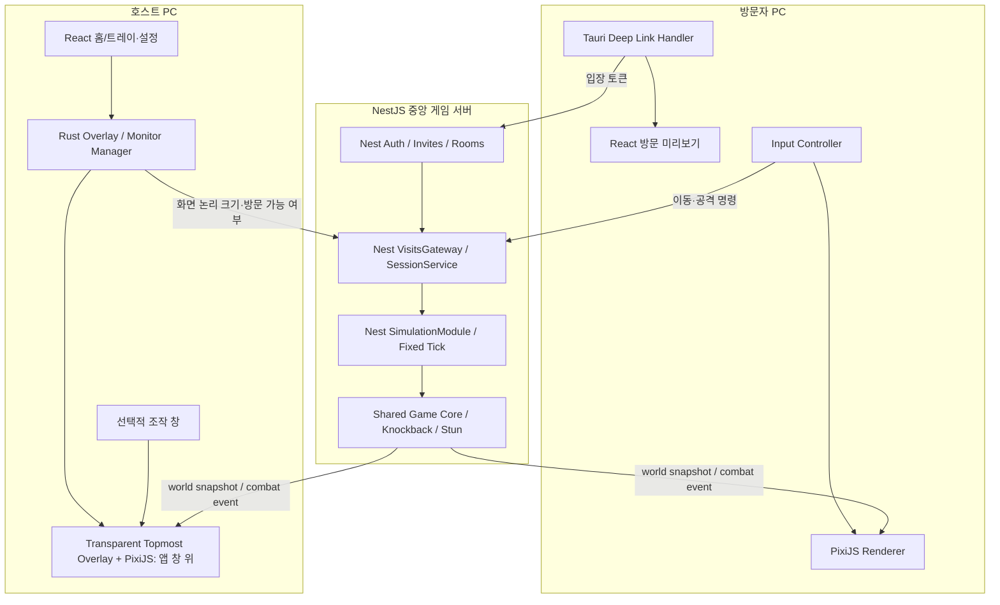
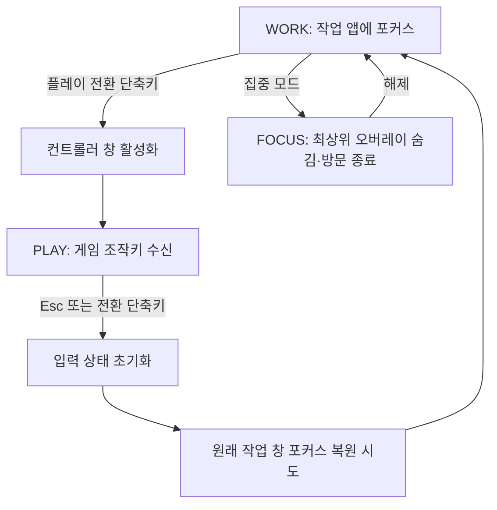

# DeskBrawl 구현 계획 및 기술 설계

> 문서 버전: v1.4 · 작성일: 2026-10-20 · 상태: 개발 착수 전 기술 설계
>
> 연관 문서: [기획안](./DeskBrawl_01_Proposal.md) · [기능 명세](./DeskBrawl_02_Functional_Spec.md) · [기술 아키텍처](./DeskBrawl_04_Technical_Architecture.md)

## 1. 기술 목표와 접근 전략

**목표:** Windows **모니터 전체의 투명한 최상위 오버레이**에 캐릭터를 표시하고, 초대 링크로 친구의 PC에 즉시 방문하여 **넉백·기절만 있는 장난 상호작용**을 실시간으로 동기화한다. 일반 프로그램 위에서 보이되 **클릭·키보드·포커스를 가로채지 않는다**.

**핵심 개발 원칙**

1. 기능보다 먼저 **최상위 투명 오버레이(작업 창 위 Z-order)와 입력·포커스 비방해**를 검증한다.
2. 네트워크 구현보다 먼저 **로컬 2캐릭터 충돌·넉백**을 완성한다.
3. 실제 OS 화면 정보를 전송하지 않고 **순수 게임 상태만** 전달한다.
4. 서버가 이동과 공격 판정의 최종 상태를 결정한다.
5. 단계마다 실제 Windows 장비 두 대로 동작을 검증한다.

### 권장 기술 스택 (Tauri 2 · NestJS 중심)

| 계층 | 추천 기술 | 역할 |
|---|---|---|
| 빌드/패키지 | pnpm workspace + TypeScript | 클라이언트/서버/공유 로직 통합 |
| 데스크톱 네이티브 | **Tauri 2 + Rust + Win32(필요 시)** | 투명 최상위 창·모니터·포커스·트레이·딥링크 |
| 앱 UI | React + Vite + Tailwind CSS + shadcn/ui | 설정·호스트 상태·방문 미리보기 |
| 게임 렌더링 | **PixiJS 8** | 스프라이트·이펙트·보간/예측 렌더링 |
| 클라이언트 상태 | Zustand + TanStack Query | 로컬 모드·설정 / REST 서버 데이터 분리 |
| 실시간 클라이언트 | socket.io-client | 게임 입력·월드 상태 동기화 |
| 백엔드 | **NestJS + TypeScript + Socket.IO Gateway** | API·방 세션·링크·실시간 이벤트 라우팅 |
| 인증·유효성 검증 | Nest Guards/JWT + Zod | 장치·호스트 권한, 이벤트 런타임 검증 |
| 영속 데이터 | PostgreSQL + Prisma | 기기·룸·링크 해시·호스트 설정 |
| 게임 시뮬레이션 | Nest SimulationModule + `packages/game-core` | 서버 권위 게임 상태, 고정 tick |
| 테스트 | Vitest·RTL·Rust tests, Nest TestingModule·Supertest·Socket E2E | 계층별 테스트 및 Windows 실기기 검증 |
| 배포 | Tauri Windows NSIS/MSI + Nest Docker | 설치·업데이트/중앙 서버 |

> **MVP 기술 원칙:** 실시간 게임 월드는 서버 메모리에 보관한다. PostgreSQL은 토큰·호스트 정보 등 영속 데이터에만 사용하며, Redis/분산 배포는 P2 후순위다. Prisma 최신 메이저와 어댑터는 공식 문서에 맞춰 호환 버전을 lockfile로 고정한다. 전체 의존성 및 모듈별 선택 근거는 [상세 기술 아키텍처](./DeskBrawl_04_Technical_Architecture.md)에 기록한다.

## 2. 전체 아키텍처



**추가 설계:** HTTP 요청(장치 인증·초대 링크·호스트 설정)은 Nest REST Controller가, 플레이어 입장·입력·snapshot은 `@WebSocketGateway()`가 처리한다. Gateway는 통신/인가 계층으로만 사용하고 실제 시뮬레이션은 주기적으로 동작하는 `SimulationEngine` Provider가 수행한다. DB와 게임 tick을 결합하지 않는다.

### 데이터 흐름의 경계

- **클라이언트 → 서버:** 입장 토큰, 입력 방향, 공격 명령, 세션 제어 명령, 호스트 측 게임 영역 크기 등.
- **서버 → 클라이언트:** 캐릭터 상태, 투사체 상태, 피격/넉백 이벤트, 접속/종료 이벤트. 호스트의 화면 가림/노출 여부와 무관하게 같은 월드를 동기화한다.
- **절대 전송하지 않음:** 화면 캡처, 열린 창 제목, 코드/문서 내용, 클립보드, 시스템 키 입력 기록.

## 3. 실행 프로세스 및 창 구조

| 창 또는 프로세스 | 담당 | 입력 처리 | 가시성 |
|---|---|---|---|
| `main` | 링크, 설정, 방문 상태 | 일반 UI | 사용자가 열 때 |
| `overlay` | **모니터 전역 최상위 투명 창**의 호스트 캐릭터·이펙트 렌더링 | 전체 입력 통과·포커스 비획득 | WORK/PLAY 중, 일반 앱 창 위 |
| `visit` | 방문자의 게임 조작·미리보기 | 게임 키 입력 수신 | 친구 방문 중 |
| `controller`(선택) | 호스트가 직접 놀 때 조작 | 게임 키 입력 수신 | 플레이 모드에만 |
| `tray` | 모드 전환·종료 | 트레이 메뉴 | 백그라운드 상주 |
| Socket.IO 서버 | 방문/동기화/판정 | 네트워크 입력 | 원격 실행 |

### Windows 최상위 투명 오버레이 전략 (M0에서 검증)

**사용자에게 보이는 규칙**

- 게임 요소는 **모니터 전체에 대응하는 투명한 최상위 창**에 표시된다. 열린 VS Code·Chrome·탐색기 위에서도 캐릭터가 보인다.
- 화면에는 캐릭터·돌·이펙트만 보이고 배경은 완전히 투명하다. **별도의 게임 배경이나 검은 사각형을 표시하지 않는다.**
- 마우스 클릭·드래그·스크롤은 아래 앱과 바탕화면으로 전달되고, 오버레이는 키보드 포커스를 가지지 않는다.
- 호스트가 작업 중에도 피격 애니메이션이 보이지만 코드/문서/웹페이지 내용은 바뀌지 않는다. 집중 모드·이펙트 축소로 시각적 간섭을 제어한다.
- UAC 보안 데스크톱, 잠금 화면, 일부 독점 전체 화면 또는 다른 최상위 창은 예외가 될 수 있으며 보안 경계 우회는 하지 않는다.

**권장 PoC 경로: Tauri 2 투명 창 + PixiJS, 필요한 범위에서 Rust Win32 보완**

1. `Tauri 2`의 독립된 렌더링 웹뷰 창 `overlay`를 `transparent: true`, `decorations: false`, `alwaysOnTop: true`, `skipTaskbar: true`, `focus: false`, `shadow: false`, `resizable: false`로 생성한다. Windows 주 모니터의 실제 디스플레이 경계와 DPI를 읽어 크기·좌표를 맞춘다.
2. PixiJS 캔버스/웹뷰 배경의 투명도를 검증하고 스프라이트와 파티클만 렌더링한다. 검은/흰 배경, 그림자, 테두리, 스크롤바가 없어야 한다.
3. `overlay.setIgnoreCursorEvents(true)`를 적용해 마우스 이벤트를 **전체 통과**시킨다. 게임 오브젝트 클릭은 MVP에서 포기하고 설정/강퇴/집중 모드는 `main` 창이나 트레이로 제공한다. 사용 시 필요한 Tauri 창 권한도 선언한다.
4. 포커스 비획득 여부를 검증한다. Windows 특이 동작이 있으면 Win32 `WS_EX_NOACTIVATE`, `SWP_NOACTIVATE` 등을 검토하되, 단순히 CSS `pointer-events: none`만 설정해서 OS 수준 클릭 통과가 된다고 가정하지 않는다.
5. `alwaysOnTop`가 일반 앱 창 위에 지속되는지 Windows 10/11의 Alt+Tab, 최대화, 창 이동, Win+D, DPI 변경, Explorer 재시작 등의 시나리오로 테스트한다. 다른 최상위 창과의 순서는 보장하지 않는다.
6. 기본 작업 모드에서 I/J/K/L/U/O를 전역 등록하지 않는다. 별도 `controller`/`visit` 창에 포커스가 있을 때만 조작하며 키 눌림 잔류를 방지한다.
7. 오버레이가 입력을 가로채거나 포커스를 뺏는 문제가 발생하면 **즉시 숨기는 안전한 폴백**을 적용하고 트레이에서 복구하도록 한다. 작업 중 강제 포커스·창 Z-order 재탈취 루프는 금지한다.
8. 작업 표시줄·알림·상대적으로 중요한 화면 부분을 가리는 문제는 게임 이동 경계/효과 크기·최대 표시 수로 완화한다. 실제 화면 정보는 서버로 전송하지 않는다.

**기술적 주의:** Windows `WS_EX_TOPMOST`는 일반 비최상위 창보다 위에 두는 효과이지 모든 OS UI 위에 강제로 표시한다는 뜻이 아니다. `WS_EX_TRANSPARENT` 자체는 페인팅 순서와 관련되므로 클릭 통과 정책을 이것만으로 설명하지 않는다. 투명 창과 마우스 전달은 실제 Tauri API 및 실기기 테스트로 보장해야 한다.

**최소 창 설정 예시(핵심 옵션만 발췌)**

```json
{
  "label": "overlay",
  "transparent": true,
  "decorations": false,
  "alwaysOnTop": true,
  "skipTaskbar": true,
  "focus": false,
  "shadow": false,
  "resizable": false
}
```

```ts
import { getCurrentWindow } from "@tauri-apps/api/window";

// 오버레이 전용 웹뷰에서 초기화 (권한 설정 필요)
await getCurrentWindow().setIgnoreCursorEvents(true);
```

**검증 참고 자료**
- [Tauri 2 Window options](https://v2.tauri.app/reference/config/)
- [Tauri 2 Window API](https://v2.tauri.app/reference/javascript/api/namespacewebviewwindow/)
- [Microsoft Windows Extended Window Styles](https://learn.microsoft.com/en-us/windows/win32/winmsg/extended-window-styles)
- [Microsoft SetWindowPos](https://learn.microsoft.com/en-us/windows/win32/api/winuser/nf-winuser-setwindowpos)

## 4. 입력/포커스 제어 구현

### 기본 키 설계

- 이동: `I/J/K/L`
- 근접 공격: `U`
- 돌 던지기: `O`
- 플레이 전환: `Ctrl+Shift+F12` (사용자 설정 가능)
- 플레이 종료: `Esc`

**중요:** `I/J/K/L/U/O`는 **전역 단축키가 아니다.** `visit` 또는 `controller` 창이 포커스를 가진 동안의 `keydown`/`keyup`만 읽는다.



**구현 주의 사항**

- `blur`, `visibilitychange`, 창 최소화, 네트워크 단절 시 눌린 키 집합을 즉시 비운다.
- 전환 단축키 등록에 실패하면 사용자가 변경하거나 트레이 메뉴로 실행하도록 한다.
- 전역 단축키 중복 등록·OS/IDE 단축키 충돌을 테스트한다.
- 포커스 복원은 Windows 환경과 권한에 따라 제한될 수 있어 실패 시에도 작업 앱 입력을 가로채지 않도록 설계한다.
- 최상위 오버레이에 포커스를 주지 않는다. 게임 조작은 별도 창에서만 받는다.

## 5. 방문 링크 및 세션 설계

### 링크 입장 UX

1. 호스트의 앱이 활성화되면 서버에 자신의 방문 공간을 등록한다.
2. 서버는 추측 불가능한 랜덤 토큰을 생성하고 링크를 반환한다.
3. 방문자가 링크를 클릭한다.
4. 설치된 앱이 링크를 처리하도록 브라우저/커스텀 스킴 연결을 제공한다.
5. 설치되어 있지 않다면 설치 페이지를 거친 뒤 재입장할 수 있도록 링크를 보존한다.
6. 앱은 서버에 토큰을 전달하고 별도 승인 없이 `visit:joined`를 받는다.
7. 호스트가 집중 모드이거나 오프라인이면 입장 오류를 보여준다.

**예시(실제 운영 URL 아님)**

- 공유 웹 링크: `https://deskbrawl.example/join/<invite-token>`
- 앱 링크: `deskbrawl://join/<invite-token>`

**Tauri 통합 주의:** Windows에서 앱이 이미 실행 중일 때 딥링크가 별도 프로세스로 실행되는 문제를 피하려면 `deep-link` 플러그인과 `single-instance` 플러그인 연계를 검증한다. 설치된 앱에서 딥링크가 동작하도록 Windows 설치 패키지까지 통합 테스트한다.

### NestJS 기반 서버 유스케이스

| 구분 | 모듈/접점 | 기능 |
|---|---|---|
| REST | `AuthController`, `RoomsController`, `InvitesController` | 장치 등록·방 상태·초대 발급/회전 |
| Socket.IO | `VisitsGateway` | 즉시 입장, 이동/공격 수신, 상태 전파 |
| 도메인 | `RoomsService`, `InvitesService`, `VisitSessionService` | 소유권, 정원·집중 모드, 방문 수명주기 |
| 게임 | `SimulationEngine`, `WorldManager` | 고정 tick, 넉백·기절·경계 판정 |
| 영속 | `PrismaModule` | 기기·룸·토큰 해시 유지 |

**NestJS 주의:** 비동기 `handleConnection()`이 끝나기 전에 메시지가 도착할 수 있으므로 Socket.IO 연결 미들웨어와 각 메시지 Guard/Service에서 권한을 검증한다. 장치 정보·초대 토큰 원문을 그대로 클라이언트 이벤트로 브로드캐스트하지 않는다.

### 토큰 및 권한 구조

- **호스트 기기 인증:** 최초 실행 시 서버에서 생성한 식별자와 기기 자격 증명을 앱의 안전한 로컬 저장 영역에 보관한다. 닉네임으로 호스트임을 판단하지 않는다.
- **초대 토큰:** 암호학적으로 안전한 무작위 바이트를 사용하며, 서버 저장 시 해시로 관리하는 방안을 권장한다.
- **토큰 처리:** 로그·분석 이벤트·오류 메시지에 평문 토큰이 남지 않도록 마스킹한다.
- **방문자 접근:** 토큰이 유효하면 별도 호스트 승인 없이 입장한다.
- **재발급:** 이전 토큰의 신규 입장을 즉시 막고 새 토큰 발급. 기존 세션 종료는 별도 동작.
- **강퇴:** 호스트로 인증된 연결만 실행 가능. 강퇴 즉시 해당 방문 세션의 입력을 차단한다.
- **차단:** 집중 모드에서는 기존 세션 종료 및 신규 입장 차단.
- **악용 방지:** IP/기기별 입장 시도 빈도 제한, 최대 참가자 수, 토큰 검증 레이트 리밋, 필요 시 사용자 차단 목록.

### 기초 DB 모델(영속성 도입 시)

```text
DeviceIdentity(id, publicNickname, createdAt, revokedAt)
HostRoom(id, ownerDeviceId, status, maxParticipants, updatedAt)
InviteToken(id, hostRoomId, tokenHash, createdAt, revokedAt)
BlockedVisitor(id, hostRoomId, visitorDeviceId, createdAt)   # 선택
```

실시간 `VisitSession`, `PlayerState`, `ProjectileState`는 MVP에서 서버 메모리에 유지한다. 프로덕션에서 수평 확장이 필요할 때 별도의 룸 소유 노드/상태 공유 전략을 설계한다.

## 6. 게임 엔진과 서버 권위 판정

### 월드 모델

- **MVP 이동:** 탑다운 2D, 상하좌우 + 대각선, 중력/점프 없음.
- **공간:** 호스트 주 모니터에 대응하는 논리 좌표계.
- **플레이어:** 호스트 1명 + 방문자 최대 3명(P1).
- **장난:** 근접 공격, 돌 던지기, 넉백, 짧은 기절, 피격 면역.
- **없는 것:** 체력, 사망, 리스폰, 승리 조건, 처치 보상.

### NestJS 게임 실행 책임

- `VisitsGateway`는 유효한 명령을 검증·큐잉하고 게임 상태 계산을 직접 호출하지 않는다.
- `WorldManager`는 세션 별 월드 및 진행 중 입력을 소유한다.
- `SimulationEngine`은 단일 고정 tick 루프로 `packages/game-core`의 `advance()`를 실행하며 캐치업 상한과 모니터링 지표를 둔다.
- `SnapshotBroadcaster`는 최신 tick을 Room으로 전파한다. 이 주기에는 Prisma 조회/저장이 들어가지 않는다.
- `InvitesService`와 `RoomsService`만 Prisma의 영속 데이터에 접근한다.

### 게임 루프(개략 의사코드)

```ts
const TICK_MS = 50; // 초기 20 ticks/s

function simulate(world: World, nowTick: number) {
  // 1. 유효한 참여자 입력만 적용
  // 2. 기절 상태라면 이동 입력 무시
  // 3. 이동 속도/대각선 정규화 반영
  // 4. 투사체 이동 및 충돌 검사
  // 5. 서버에서만 근접/돌 타격 판정
  // 6. 적중 시 넉백 벡터와 기절 종료 tick 갱신
  // 7. 캐릭터 충돌 박스를 화면 경계 안에 유지
  // 8. 판정·타이머 갱신 후 snapshot 전송
}
```

**시간 기준:** 재현성과 클라이언트 동기화를 위해 기절 종료 시각을 임의의 클라이언트 시간 대신 서버 tick 또는 서버 기준 시간으로 관리한다.

### 공격 판정 원칙

- 클라이언트는 `melee`·`stone` 명령만 보낸다. 대상·최종 적중 여부·피격 좌표는 서버가 결정한다.
- 근접 공격은 서버 기준 공격자의 위치·방향·사거리·쿨다운을 검사한다.
- 돌은 서버에서 생성하고 이동·충돌을 계산한다.
- 피격 시 대상의 `knockbackVelocity`와 `stunnedUntilTick`을 변경한다.
- 피격 면역 시간에는 추가 타격을 무시하여 무한 기절을 방지한다.
- 경계 근처 넉백은 좌표를 월드 안으로 제한한다. 캐릭터는 소멸하지 않는다.
- 돌이 경계에 닿으면 떨어지거나 튕기는 연출 후 투사체 리소스를 정리한다.

### 이동 예측·보간

1. 로컬 캐릭터는 현재 입력으로 이동을 즉시 예측한다.
2. 서버는 입력 시퀀스(`seq`)를 기준으로 순서가 뒤처진 입력을 무시한다.
3. 서버 스냅샷에 확인된 마지막 입력 시퀀스를 포함한다.
4. 클라이언트는 예측과 서버 결과의 차이를 보정한다.
5. 타인의 캐릭터는 최근 두 스냅샷 사이에서 보간하여 그린다.
6. 명중 여부는 서버에서 확정한 후 모든 참여자에게 동일하게 반영한다.

**초기 목표값(튜닝 대상):** 서버 20 ticks/s, 상태 스냅샷 10~20 Hz, 렌더링 최대 60 FPS, 작업 모드에는 별도 렌더링 제한. 실제 값은 2~4명 실기기 테스트로 정한다.

### 네트워크 메시지 정책

| 메시지 | 성격 | 권장 방식 |
|---|---|---|
| 이동 입력 | 최신 값 중요 | 순번 검사, 오래된 값 폐기, 필요 시 volatile |
| 게임 스냅샷 | 최신 값 중요 | tick 검사, 중간 스냅샷 일부 누락 허용 |
| 입장/강퇴 | 도착 여부 중요 | ack, 타임아웃, 권한 검증, 멱등 처리 |
| 근접·투척 명령 | 중복 위험 | actionId, 서버 측 중복 제거·쿨다운 검증 |
| 피격 확정 | 상태 일관성 중요 | 이벤트 + 후속 snapshot 일치 검증 |

Socket.IO는 이벤트 순서를 보장하지만 기본 전달 보장은 at-most-once이므로, 재연결 시 과거 이벤트를 모두 재실행하기보다 **새 전체 스냅샷으로 재동기화**한다.

## 7. 좌표계·해상도 처리

호스트의 게임 좌표를 **논리 월드 좌표**로 표현하고, 방문자는 같은 월드를 자신의 미리보기 크기에 맞춰 축소·확대한다.

```text
worldWidth, worldHeight  = 호스트의 논리 게임 크기
viewWidth, viewHeight    = 방문자 미리보기의 가용 크기
scale = min(viewWidth / worldWidth, viewHeight / worldHeight)
offsetX = (viewWidth - worldWidth * scale) / 2
offsetY = (viewHeight - worldHeight * scale) / 2
viewX = offsetX + worldX * scale
viewY = offsetY + worldY * scale
```

- 종횡비를 유지하므로 해상도가 달라도 상대 좌표가 보존된다.
- 서버에 OS 화면 이미지, 프로그램 목록, 창 제목을 보내지 않는다.
- 호스트의 디스플레이 크기가 바뀔 경우 현재 월드 크기를 갱신하고 모든 캐릭터를 유효 범위로 보정한다.
- DPI/멀티 모니터는 플랫폼 별 좌표계 차이가 큰 영역이므로 MVP에는 단일 모니터만 정식 지원한다.

## 8. 모노레포 및 모듈 설계

```text
deskbrawl/
├── apps/
│   ├── desktop/
│   │   ├── src/
│   │   │   ├── windows/{main,visit,overlay,controller}/
│   │   │   ├── features/{invites,session,controls,focus,settings}/
│   │   │   ├── game/{pixi,animation,world-buffer,input,prediction}/
│   │   │   └── shared/{api,socket,tauri,stores}/
│   │   └── src-tauri/
│   │       ├── src/{lib,commands,window_manager,monitor,tray,deeplink}.rs
│   │       ├── capabilities/{main,visit,overlay}.json
│   │       └── tauri.conf.json
│   └── server/
│       ├── src/
│       │   ├── modules/{auth,rooms,invites,visits,simulation,health}/
│       │   ├── infrastructure/{prisma,socket,logging}/
│       │   ├── common/{pipes,guards,filters}/
│       │   ├── app.module.ts
│       │   └── main.ts
│       ├── prisma/{schema.prisma,migrations}/
│       └── test/{rest,ws}/
├── packages/
│   ├── protocol/       # TS 타입 + Zod 입출력 계약/이벤트 버전
│   ├── game-core/      # 순수 TS 이동·충돌·넉백·기절·경계 함수
│   └── game-assets/    # 스프라이트·시트·애니메이션 정의
├── infra/{docker,deploy}/
└── pnpm-workspace.yaml
```

### 책임 분리

- `game-core`: 프레임워크 독립적인 이동, 사거리, 투사체, 넉백, 경계 처리의 **순수 함수**.
- `protocol`: HTTP/Socket 이벤트, 데이터 타입, Zod 스키마, 에러 코드.
- `desktop/game/pixi`: PixiJS 씬 그래프, 보간·애니메이션. React 프레임별 리렌더를 피한다.
- `desktop/game/input`: 조작 창 전용 입력, 키 매핑, blur 시 상태 초기화.
- `desktop/src-tauri`: 투명 최상위 창 제어·모니터 배율/크기, 포커스·트레이·딥링크·OS 권한.
- `server/modules/visits`: Nest `@WebSocketGateway`, Socket.IO Room, 권한/세션 처리.
- `server/modules/simulation`: 게임 tick, 입력 큐, 스냅샷, 서버 권위 판정.
- `server/modules/{rooms,invites,auth}`: Nest REST API, 초대 링크·호스트 소유권, Prisma 접근.

**의존 방향:** desktop/server → protocol/game-core. 공유 패키지는 Nest/React/Tauri에 의존하지 않는다. 백엔드 Gateway가 게임 충돌 로직이나 ORM 코드를 직접 갖지 않도록 하고 Nest 서비스로 위임한다.

## 9. 단계별 개발 계획

일정은 소규모 팀 기준 **예시 작업 순서**이며 확정 납기나 개발 기간을 의미하지 않는다. 각 단계의 종료 조건을 충족해야 다음 단계로 이동한다.

### M0. 기술 검증: 최상위 투명 오버레이와 입력 통과

**할 일**
- [ ] Tauri 2 + React + Vite 프로젝트 생성 및 Windows 패키징
- [ ] `alwaysOnTop: true`, `transparent: true`, 창 장식 제거, 작업 표시줄 제외 설정 검증
- [ ] PixiJS 캐릭터 1개가 VS Code·Chrome **최대화 창 위**에서도 보이는지 확인
- [ ] `setIgnoreCursorEvents(true)` 적용 후 클릭·드래그·우클릭·스크롤이 아래 앱에 전달되는지 확인
- [ ] IDE 편집 키, 단축키, Alt+Tab 등에서 오버레이가 포커스를 빼앗지 않는지 확인
- [ ] 배경 알파=0, DPI/해상도 변경, Win+D, Explorer 재시작 등 Windows 시나리오 테스트
- [ ] 트레이 메뉴에서 캐릭터 표시/숨김과 효과 감소 설정 제공
- [ ] Windows 10/11(지원 대상 후보) 실기기 테스트 및 보안 데스크톱/독점 전체 화면 예외 기록

**완료 기준:** 일반 프로그램 창 위에서 캐릭터가 보이면서도 **클릭·드래그·스크롤·키보드·포커스 방해가 없다.** 투명 배경과 모니터 좌표가 정상이고, 오류 시 오버레이를 안전하게 숨길 수 있다. 이 조건을 만족하지 못하면 다음 단계로 진행하지 않는다.

### M1. 로컬 장난 게임

**할 일**
- [ ] PixiJS 캐릭터 스프라이트 및 idle/walk/attack/stun 애니메이션
- [ ] IJKL 이동, U 근접 공격, O 돌 던지기
- [ ] 로컬 가상 캐릭터 2개로 공격·돌 충돌 구현
- [ ] 넉백·기절·피격 면역·화면 경계 처리
- [ ] 순수 로직 Vitest 단위 테스트
- [ ] `WORK`와 `PLAY` 입력 분리, 키 매핑 설정

**완료 기준:** 로컬 게임에서 타격·넉백·기절이 자연스럽고 캐릭터는 공격으로 사라지지 않는다. 개발 앱 입력과 충돌하지 않는다.

### M2. 링크 기반 방문과 2인 동기화

**할 일**
- [ ] NestJS 프로젝트 초기화, `RoomsModule`·`InvitesModule`·`VisitsModule`·`SimulationModule` 생성
- [ ] Nest REST API + Prisma/PostgreSQL로 기기/룸/초대 토큰 생성·해시 저장·재발급
- [ ] Tauri 딥링크 + 단일 인스턴스 동작 검증
- [ ] Nest `VisitsGateway`에 `visit:join`, `visit:leave`, `world:snapshot`와 `player:input` 연결
- [ ] 호스트 **최상위 투명 오버레이**와 방문자 미리보기의 월드 좌표·상태 동기화
- [ ] Nest `SimulationEngine` 고정 tick + 공유 `game-core` 기반 서버 권위 공격·돌 판정 및 2 PC 동기화
- [ ] 정원 초과·링크 무효·호스트 오프라인 안내

**완료 기준:** A가 B의 링크를 클릭해 수락 없이 즉시 입장하고, A가 던진 돌에 B의 캐릭터가 맞으면 두 화면에서 동일한 넉백·기절이 보인다. 실제 화면 정보는 전송하지 않는다.

### M3. 작업 모드·호스트 제어 안정화

**할 일**
- [ ] 전역 전환 단축키·조작 창 포커스 관리
- [ ] 집중 모드 진입 시 기존 방문 종료 + 새 방문 차단
- [ ] 접속자 목록, 개별 강퇴, 모두 내보내기
- [ ] 강퇴 후 입력 차단 및 링크 재발급 경합 처리
- [ ] 중복 클릭·중복 입장·호스트 종료·키 눌림 잔류 테스트
- [ ] 앱 트레이 백그라운드 실행 및 종료 정리

**완료 기준:** 친구가 방문해도 작업이 방해되지 않고, 호스트는 언제든 집중 모드/강퇴로 자신의 화면을 통제할 수 있다.

### M4. 멀티플레이 안정화·배포

**할 일**
- [ ] 재연결과 스냅샷 기반 상태 복구
- [ ] 입력 시퀀스·중복 actionId·이전 세션 이벤트 무시
- [ ] 호스트 포함 총 4명 테스트
- [ ] 네트워크 지연·끊김 시뮬레이션, 서버 리소스 측정
- [ ] Tauri Windows NSIS/MSI, updater 서명·키 관리, Nest Docker 이미지 및 PostgreSQL 배포
- [ ] 베타 사용성 테스트 및 키보드/피격 강도 튜닝

**완료 기준:** 2~4명이 게임 상태를 공유하고, 일시적 단절과 세션 재입장 뒤에도 중복 캐릭터·오래된 공격·입력 고착이 생기지 않는다.

### M5. 후속 확장(선택)

- [ ] 픽셀 캐릭터 스킨, 이모트
- [ ] 화면 최상위 장난 아이템·이모트 추가(일반 앱 위에 표시하되 입력은 통과)
- [ ] 멀티 모니터, 고주사율, macOS 검토
- [ ] 장난 아이템/애니메이션 추가(처치 없는 원칙 유지)

## 10. 기술 리스크·대응 및 의사결정 기준

| 위험 | 원인 | 대응 | 중단/변경 기준 |
|---|---|---|---|
| 최상위/투명 표시 불안정 | Windows·WebView 투명 합성/최상위 창 차이 | Windows 빌드별 PoC, 실제 앱 창 겹침·DPI 검증, 필요 시 Win32 스타일 보완 | 일반 앱 위에 보이지 않거나 불투명 영역이 생기면 릴리스 중단 |
| 클릭·포커스 간섭 | 최상위 창이 OS 입력/포커스 처리에 개입 | Tauri 클릭 통과·비활성 옵션·필요 시 Win32 보완·별도 컨트롤러 | 일반 앱 클릭/스크롤/키 입력이 막히면 오버레이 안전 숨김 및 릴리스 중단 |
| 글로벌 단축키 충돌 | IDE/다른 앱 단축키 중복 | 전환 키만 전역 등록, 재설정·트레이 대안 | 등록 불가능 시 게임 동작 유지·메뉴로 대체 |
| 딥링크 중복 프로세스 | Windows 앱 연결 방식 | `single-instance` 통합 검증 | 중복 캐릭터·앱 생성 시 입장 흐름 수정 |
| 링크 노출·무단 방문 | 링크 보유자 즉시 입장 | 고엔트로피 토큰·재발급·강퇴·차단 | 토큰 평문 로그 노출·권한 우회 발견 시 배포 중단 |
| 공격 판정 불일치 | 지연·예측 오차·동시성 | 서버 권위 판정·seq/actionId·스냅샷 | 2 PC 간 상충 결과 반복 시 네트워크 로직 수정 |
| 연결 종료 후 잔류 상태 | 늦게 도착한 이벤트 | visitId/세션 epoch 검증, 입력 초기화 | 유령 캐릭터·영구 기절 재현 시 릴리스 차단 |
| 스냅샷 지연/렌더링 부담 | 최상위 오버레이 상시 렌더링 | 작업 모드 시 프레임·파티클 제한/프로파일링 | 실제 작업 성능에 유의미한 악영향 시 최적화 우선 |
| DPI 오차 | 물리·논리 좌표 혼용 | 모니터 스케일을 기준으로 변환 | 경계 이탈이 빈번하면 단일 배율 범위 제한 |

## 11. 테스트 계획

### 11.1 단위 테스트(Vitest, Nest TestingModule, Rust)

- [ ] 4방향·대각선 입력 정규화
- [ ] 서버 월드 좌표 경계 제한
- [ ] 근접 사거리·각도 판정
- [ ] 돌의 이동·충돌·투사체 정리
- [ ] 넉백 벡터 방향과 감쇠
- [ ] 기절 종료·피격 면역 시간
- [ ] 잘못된 입력/음수 좌표/비정상 수치 차단
- [ ] 이벤트 seq·actionId 멱등 처리
- [ ] 토큰 만료·재발급·권한 판정

### 11.2 통합 테스트(Nest REST + Socket.IO, 클라이언트 2~4개)

- [ ] Nest Controller + Prisma 테스트 DB + Supertest의 장치/초대/룸 API 검증
- [ ] Nest `VisitsGateway` Guard, 액션 DTO Zod 검증, 잘못된 토큰 차단
- [ ] Nest 게임 tick과 DB I/O가 독립적으로 동작하는지 검증

- [ ] 정상 링크 입장 및 자동 세션 생성
- [ ] 중복 링크 클릭 시 플레이어 하나만 생성
- [ ] 즉시 입장과 집중 모드 전환이 경쟁할 때 원자적 판정
- [ ] 한 클라이언트가 공격하면 모두 동일한 판정 관찰
- [ ] 호스트 강퇴 후 추가 명령이 반영되지 않음
- [ ] 500ms 이상의 지연 상황을 포함해 보간/복구 확인(테스트 조건; 목표 지연 아님)
- [ ] 연결 단절·재접속 후 상태 일치 및 중복 방지

### 11.3 Windows 실기기 시나리오

- [ ] VS Code 코드 입력, 자동완성, 드래그, 스크롤
- [ ] Chrome 탭 전환, 클릭, 링크 열기
- [ ] Alt+Tab 전환, 트레이 메뉴, 창 최소화·복원
- [ ] 배율 100%/125% 등 지원 범위 테스트
- [ ] 게임 창 포커스 해제 시 이동 정지
- [ ] 집중 모드와 플레이 모드 전환
- [ ] 설치된 앱에서 딥링크 한 번 클릭으로 연결
- [ ] Windows 재시작 후 설정·링크 복구 동작 확인
- [ ] VS Code·Chrome 최대화 시 캐릭터가 **창 위에 표시**되는지 확인
- [ ] Alt+Tab·창 최소화/복원·Win+D 등에서 오버레이와 포커스 상태 검증
- [ ] 오버레이 아래 앱의 클릭·드래그·우클릭·스크롤 및 바탕화면 아이콘 클릭 정상 동작 확인
- [ ] `explorer.exe` 재시작·DPI/해상도 변경 후 오버레이 좌표 복구 또는 안전한 숨김 확인

### 11.4 보안/프라이버시 검증

- [ ] 네트워크 패킷에 화면/창 제목/클립보드가 없음
- [ ] 장치/호스트 자격 증명이 일반 게임 패킷에 실리지 않음
- [ ] 토큰 평문이 서버 로그·분석 도구·오류 응답에 유출되지 않음
- [ ] 방문자가 호스트 제어 명령을 위조할 수 없음
- [ ] 레이트 리밋·무효 토큰 브루트포스 대응
- [ ] Tauri 창별 Capability 최소 권한 확인

## 12. 관측성·성능 튜닝

**수집할 개발 측정값**

- 연결 성공/실패 및 실패 코드(토큰 원문 제외)
- WebSocket round-trip latency, 재연결 횟수
- 스냅샷 주기·실제 수신 간격, 클라이언트 렌더 FPS
- CPU/GPU 사용량, 활성/작업/집중 모드별 차이
- 서버 tick 계산 시간, 세션당 메모리 사용량
- 공격 명령과 확정 피격 이벤트 간 시간

**개인정보 원칙:** 계정·기기 정보와 이벤트를 최소 수집한다. 원격 화면, 키보드 로그, 채팅 내용은 분석 용도로 수집하지 않는다.

## 13. 추천 첫 이터레이션 작업 티켓

| 순서 | 티켓 | 산출물 | 완료 체크 |
|---|---|---|---|
| 1 | DB-001 Tauri 초기화 | desktop 앱 실행 | Windows 설치 및 트레이 실행 |
| 2 | DB-002 Topmost Overlay PoC | 투명 최상위 창 + 픽셀 캐릭터 | **앱 창 위에 보이고 클릭은 통과** |
| 3 | DB-003 Work/Play 분리 | 전환·포커스 관리 | 작업 중 일반 키 간섭 없음 |
| 4 | DB-004 PixiJS Game Core | 이동/돌/근접 판정 | 단위 테스트 통과 |
| 5 | DB-005 넉백·기절 | 피격 상태 머신 | 처치·소멸 없이 복구 |
| 6 | DB-006 링크·딥링크 | 토큰 발급/앱 실행 | 수락 없이 바로 입장 |
| 7 | DB-007 2인 동기화 | 서버 룸·스냅샷 | 두 PC 피격 결과 동일 |
| 8 | DB-008 강퇴·집중 모드 | 호스트 제어 | 즉시 차단·정상 귀환 |
| 9 | DB-009 재접속 테스트 | 세션 epoch/상태 복원 | 중복·유령 상태 없음 |
| 10 | DB-010 베타 패키징 | 설치 파일·테스트 기록 | 실제 친구 2~4명 테스트 |

## 14. Tauri·NestJS 도입 작업 체크

- [ ] `desktop`: Tauri 2, React/Vite, PixiJS 8, Zustand, Tailwind/shadcn/ui 설치 및 overlay/main/visit 창 분리
- [ ] `src-tauri`: 최소 Capability 정책, 글로벌 단축키, single-instance/deep-link, 트레이, Windows 모니터 좌표 검증
- [ ] `server`: Nest CLI 앱, Config/Auth/Rooms/Invites/Visits/Simulation/Prisma 모듈 구성
- [ ] `server`: REST Controller와 WebSocket Gateway 수명주기 분리, 각 이벤트 별 인증/검증·에러 코드
- [ ] `packages/protocol`: Zod 스키마로 입력 타입과 런타임 계약 단일화
- [ ] `packages/game-core`: 완전한 순수 TS 및 경계/피격 테스트 확립
- [ ] 인수 테스트: VS Code/Chrome 위 표시 및 클릭 통과, 링크 자동 방문, 2 PC 판정 일치

## 15. 공식 참고 자료

아래 공식 문서를 기반으로 주요 API/동작을 검증한다. 버전 업그레이드 시 변경 여부를 다시 확인한다.

- [Tauri 2 Configuration — Window options](https://v2.tauri.app/reference/config/)
- [Microsoft Win32 SetWindowPos](https://learn.microsoft.com/en-us/windows/win32/api/winuser/nf-winuser-setwindowpos)
- [Microsoft Windows Extended Window Styles](https://learn.microsoft.com/en-us/windows/win32/winmsg/extended-window-styles)
- [Tauri 2 JavaScript Window API — setIgnoreCursorEvents](https://v2.tauri.app/reference/javascript/api/namespacewebviewwindow/)
- [Tauri 2 Global Shortcut](https://v2.tauri.app/plugin/global-shortcut/)
- [Tauri 2 Deep Linking](https://v2.tauri.app/plugin/deep-linking/)
- [Tauri 2 Deep Link JS API — Single Instance note](https://v2.tauri.app/reference/javascript/deep-link/)
- [Tauri 2 Capabilities](https://v2.tauri.app/security/capabilities/)
- [NestJS WebSocket Gateway](https://docs.nestjs.com/websockets/gateways)
- [NestJS WS Guards](https://docs.nestjs.com/websockets/guards)
- [NestJS Prisma Recipe](https://docs.nestjs.com/recipes/prisma)
- [NestJS Testing](https://docs.nestjs.com/fundamentals/testing)
- [Tauri 2 Updater](https://v2.tauri.app/plugin/updater/)
- [PixiJS 8 Application](https://pixijs.com/8.x/guides/components/application)
- [Socket.IO Delivery Guarantees](https://socket.io/docs/v4/delivery-guarantees/)
- [Socket.IO Emitting Events — Volatile events](https://socket.io/docs/v4/emitting-events)

---

## 최종 개발 우선순위

**최상위 투명 오버레이 PoC → 앱 창 위 표시·입력 통과 검증 → 로컬 이동·돌·넉백·기절 → 링크 즉시 방문 → 서버 동기화 → 호스트 제어 → 재연결·다인원 안정화**

최우선 릴리스 기준은 **'친구가 방문하면 일반 작업 프로그램 위에도 캐릭터가 보이지만, 사용 중인 프로그램의 마우스·키보드·포커스를 방해하지 않는다'**이다.
