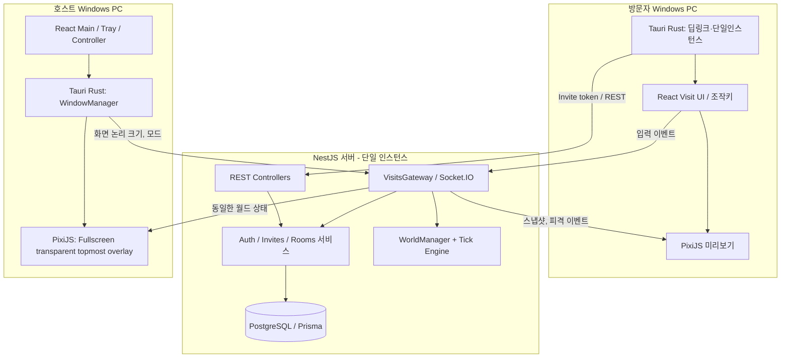

# DeskBrawl 기술 스택 및 상세 아키텍처

> 문서 버전: v1.4 · 작성일: 2026-10-20 · 상태: 권장 구현 설계 (PoC 검증 전)
>
> 연관 문서: [기획안](./DeskBrawl_01_Proposal.md) · [기능 명세](./DeskBrawl_02_Functional_Spec.md) · [구현 계획](./DeskBrawl_03_Implementation_Plan.md)

## 0. 기술 결정 요약

- **데스크톱:** Tauri 2 + Rust 네이티브 셸 + React/TypeScript/Vite + PixiJS 8.
- **백엔드:** NestJS + Socket.IO Gateway + REST API + 고정 간격 게임 시뮬레이터.
- **데이터:** PostgreSQL + Prisma. 게임 월드의 초당 수십 번 갱신되는 상태는 **DB가 아닌 서버 메모리**에 둔다.
- **공유 계약:** pnpm workspace의 `packages/protocol`(Zod + TS)과 `packages/game-core`(순수 TS).
- **필수 제약:** 일반 작업 앱 창 **위**에 보이는 투명·최상위 오버레이이되 마우스·키보드·포커스는 가로채지 않는다. 친구는 **링크만으로 즉시 입장**하며 전투 결과는 **넉백·일시적 기절**뿐이다.
- **출시 초기:** Windows 단일 모니터, 한 NestJS 서버 인스턴스, 호스트 포함 2명(P0)에서 6명(P1)까지 검증. Redis·마이크로서비스·메시지 브로커는 후순위.

## 1. 전체 기술 스택

### 1.1 클라이언트 — Tauri 중심

| 관심사 | 기술 | 역할/선정 근거 | 단계 |
|---|---|---|---|
| 네이티브 앱 컨테이너 | **Tauri 2, Rust stable** | 창 생명주기, OS 기능, 설치 프로그램 | P0 |
| Windows 연동 | Rust `windows` crate / Win32 | 모니터, DPI, 포커스·최상위 창 동작 보완 (PoC 실패 시 최소 범위) | P0 검증 |
| 앱 UI | **React + TypeScript + Vite** | 홈, 방문 미리보기, 설정, 단축키 안내 | P0 |
| UI 스타일 | Tailwind CSS + shadcn/ui + Lucide | 메인/설정 UI. **오버레이 렌더링에는 사용하지 않음** | P0 |
| 2D 게임 렌더러 | **PixiJS 8 (WebGL 우선)** | 스프라이트, 돌, 넉백·기절 애니메이션 | P0 |
| 앱 상태 | Zustand | WORK/PLAY/FOCUS, 세션 뷰, 조작키 설정 | P0 |
| API 서버 상태 | TanStack Query + fetch | 프로필·초대 링크 정보의 조회·갱신 캐시 | P1 또는 API 도입 시 |
| 실시간 | socket.io-client | 조작 입력, 게임 상태 스트림, 입퇴장 | P0 |
| 런타임 검증 | Zod | 수신 이벤트·딥링크 URL 형식 검사 | P0 |
| 로컬 설정 | Tauri plugin-store | 키 매핑, 이펙트 강도, 렌더 제한 등 **비민감** 설정 | P1 |
| 비밀정보 | Windows Credential Manager 또는 보안 저장 어댑터 | 장치 인증 자격 증명. 일반 store에 평문 저장 금지 | P0 설계 |
| 딥링크 | Tauri plugin-deep-link + plugin-single-instance | 공유 HTTPS 링크 → `deskbrawl://join/...` → 실행 중 앱 | P0 |
| 조작 모드 진입 | Tauri plugin-global-shortcut | 구성 가능한 전역 조합 **한 개만** 등록 | P0 |
| 시스템 트레이 | Tauri native tray | 집중 모드·숨기기·앱 종료 | P0 |
| 로깅·업데이트 | Tauri plugin-log, plugin-updater | 로컬 진단 로그, 서명된 업데이트 (릴리스 단계) | P1 |
| 자동 실행 | Tauri plugin-autostart | 사용자가 명시적으로 활성화한 경우만 | P1 |
| 검증 | Vitest + React Testing Library, Playwright(웹 UI), Rust tests | 논리·UI·OS 경계 분리 테스트 | P0/P1 |

**중요:** Tauri 플러그인은 각 플러그인의 Rust/JS 설정과 창별 Capability를 함께 적용해야 한다. 권한은 `main`과 `visit`에 필요한 것만 제공하고, `overlay`에는 최소 API만 허용한다.

### 1.2 백엔드 — NestJS 중심

| 관심사 | 기술 | 책임 | 단계 |
|---|---|---|---|
| 런타임/프레임워크 | **Node.js LTS + NestJS + TypeScript** | DI, 모듈, 환경설정, 앱 수명 관리 | P0 |
| HTTP API | `@nestjs/platform-express`, Controllers | 호스트 등록, 링크 생성·회전, 방문 상태 조회 | P0 |
| 실시간 | `@nestjs/websockets` + `@nestjs/platform-socket.io` | 방문, Room, 입력, 스냅샷, 강퇴 | P0 |
| 비즈니스 모듈 | `Rooms`, `Invites`, `Sessions`, `Simulation`, `Auth` | 규칙·상태·인가 계층 분리 | P0 |
| 인증 | `@nestjs/jwt`, Guards, Socket.IO 미들웨어 | 장치/호스트 세션 식별, 권한 검증 | P0 |
| 검증 | Zod + 커스텀 Nest ValidationPipe | HTTP 및 Socket 이벤트에 동일 계약 사용 | P0 |
| 데이터베이스 | PostgreSQL | 장치, 방문 공간, 초대 링크 해시, 관리 상태 | P0~P1 |
| ORM | Prisma + Prisma Migrate | 모델/마이그레이션/저장소 계층 | P0~P1 |
| 남용 방지 | `@nestjs/throttler`(REST), WS별 제한 로직 | 링크 추측, 과도한 입력·공격 차단 | P0 |
| 설정 | `@nestjs/config` + Zod 환경변수 스키마 | 비밀키·DB URL·접속 허용 도메인 관리 | P0 |
| 테스트 | Jest 또는 Vitest + `@nestjs/testing`, Supertest, socket.io-client | 로직/REST/실시간 통합 테스트 | P0 |
| 모니터링 | Nest Logger(JSON), 메트릭, request/visit correlation ID | 오류·tick 처리시간·접속 상태 추적 | P1 |
| 캐시/분산 | Redis + Socket.IO Redis adapter | 다중 인스턴스 필요 시. **adapter만으로 시뮬레이션 공유 불가** | P2 |

**ORM 주의:** Prisma 7을 사용한다면 공식 NestJS 레시피에 맞는 PostgreSQL 드라이버 어댑터(`@prisma/adapter-pg`) 및 generated client 구성을 고정해서 사용한다. 개발 시작 시 lockfile로 호환 버전을 확정한다.

## 2. 프로세스/창/네트워크 아키텍처



- **시스템 메시지 경계:** `Tauri/Rust ↔ React`는 `invoke`/Tauri events. `React ↔ NestJS`는 REST+Socket.IO. `NestJS ↔ PostgreSQL`은 Prisma.
- **금지된 데이터 흐름:** 호스트 모니터 이미지/브라우저 내용/창 제목/키 입력/클립보드/로컬 파일 경로를 방문자 또는 서버에 전송하지 않는다.
- **방문자 화면:** 방문 미리보기에는 게임 월드만 표현하고 실제 호스트 데스크톱 픽셀은 제공하지 않는다.
- **서버 권위:** 공격 대상/명중 여부/넉백/기절 종료/경계 반응은 서버가 결정한다. 클라이언트는 입력만 전송한다.

## 3. 프론트엔드 상세 설계

### 3.1 Tauri 멀티 윈도우 설계

| 라벨 | 책임 | 표시 형태 | 포커스/권한 |
|---|---|---|---|
| `overlay` | 캐릭터·돌·피격 이펙트 | 주 모니터 전체 크기, 투명, `alwaysOnTop: true`, 프레임 없음 | **항상 클릭 통과, 포커스 미획득**, 제한된 Capability |
| `main` | 초대 링크·모드·설정 | 일반 앱 창 | 일반 UI 입력, API 호출 허용 |
| `visit` | 상대 월드 미리보기·조작 | 일반 조작 창 | 포커스가 있을 때만 방향키/Z/X 수신 |
| `controller`(선택) | 호스트 자신의 캐릭터 조작 | 축소형 게임 컨트롤러 | 포커스 있을 때만 게임 키 수신 |

**최우선 기술 검증(M0):** Windows WebView2와 Tauri의 투명 웹뷰가 실제로 alpha=0을 표시하는지, VS Code/Chrome 위에서 최상위 상태가 유지되는지, 클릭·드래그·스크롤이 하위 앱에 도달하는지, 작업 앱이 포커스를 잃지 않는지 테스트한다. Tauri의 `setIgnoreCursorEvents(true)`와 `focus: false`를 우선 적용하고, 꼭 필요한 경우만 Rust/Win32의 창 스타일을 보완한다. 보안 데스크톱/독점 전체 화면은 표시 보장 범위 밖이다.

**권장 경계:** 오버레이는 조작용 UI와 물리적으로 다른 창으로 둔다. 게임 내 직접 클릭/드래그는 포기하고 필요한 제어는 `main`·트레이·`visit`에서 수행한다. 게임 도중 빈번한 Rust IPC 호출을 하지 않고, Rust는 창 제어/OS 접근만 담당한다.

### 3.2 React와 PixiJS 책임 분리

```text
React (서비스 UI)                 PixiJS (Game Renderer)
- 홈/링크/설정/상태 표시          - Sprite/AnimatedSprite
- Zustand(모드/설정/연결상태)     - move interpolation
- TanStack Query(REST 조회)      - hit/stun/knockback animation
- 친구 공간 미리보기 UI          - projectile and effect lifecycle
         │                                    ▲
         └── session client → WorldStateBuffer ┘
```

- Socket 수신 데이터는 Zod로 검증하고 `WorldStateBuffer`로 전달한다.
- PixiJS Ticker가 매 프레임 Buffer를 읽고 화면 객체를 보간해 직접 갱신한다. 스냅샷마다 React `setState()`로 전체 월드를 재렌더링하지 않는다.
- 월드 논리는 `packages/game-core`에 격리한다. 예측은 클라이언트, 최종 판정은 서버에서 실행한다.
- Render FPS: 활성 최대 60, 작업 모드에서는 낮춘 목표값을 측정 후 결정, 집중 모드는 렌더 중지·투명창 숨김. 접속 자체는 유지/종료 정책에 따라 관리.
- PixiJS 8은 `Application.init({ backgroundAlpha: 0, preference: 'webgl' })` 후 `Ticker`를 관리하고, 언마운트 시 이벤트/텍스처/리스너를 정리한다.

### 3.3 Tauri 권한과 IPC

- `overlay`: 창 표시/크기 제어만 Rust에서; 불필요한 파일·shell·OS 권한을 부여하지 않는다.
- `main`: 자신의 룸 생성·재발급·제어 API, 필요한 딥링크/트레이 기능.
- `visit`: 방문/퇴장·입력과 소켓 권한. OS 파일 권한 불필요.
- 민감한 장치 키/토큰은 JS 비민감 설정 저장소와 구분하여 OS 보호 저장소를 사용한다.
- Rust 명령은 OS 경계의 작은 유스케이스로 제한한다: `get_monitor_geometry`, `set_overlay_visibility`, `set_overlay_click_through`, `get_safe_device_credential`. 마지막 명령은 원문 자격 증명 노출 대신 **서명/세션 발급 등의 비밀 비노출 인터페이스**로 대체할 것을 우선 권장한다.
- Windows deep-link는 `plugin-deep-link`와 `plugin-single-instance`를 함께 적용하고, 외부 URL 입력값을 Zod로 검증한 뒤 서버에서 실제 토큰 권한을 재검사한다.

### 3.4 최소 오버레이 초기화 예시

아래 코드는 **Tauri `overlay` 전용 웹뷰의 개념 예시**이며, 창 생성과 Capability 설정은 별도로 필요하다.

```ts
import { getCurrentWindow } from '@tauri-apps/api/window';
import { Application } from 'pixi.js';

const overlay = getCurrentWindow();

// 오버레이에는 입력을 주지 않고, 아래 IDE/브라우저가 그대로 받도록 한다.
await overlay.setIgnoreCursorEvents(true);

const pixi = new Application();
await pixi.init({
  resizeTo: document.body,
  backgroundAlpha: 0,
  preference: 'webgl',
  antialias: false,
});
document.body.appendChild(pixi.canvas);

// 캐릭터 스프라이트는 pixi.stage에 별도로 추가한다.
// 언마운트/종료 시 ticker·이벤트·리소스 정리 필요.
```

- `overlay`의 실제 `alwaysOnTop`, `transparent`, `focus: false` 등은 Tauri 윈도우 생성 옵션에서 설정하고 **Windows 실기기 테스트로 동작을 확인**한다.
- 투명한 웹뷰가 CSS상 투명하다는 사실만으로 OS 전체 화면의 포커스·클릭 통과가 보장되는 것은 아니다.
- React는 화면/UI 구성에 사용하되, PixiJS 애니메이션 렌더링의 프레임 루프를 React 렌더와 결합하지 않는다.

## 4. NestJS 상세 설계

### 4.1 모듈/책임 분리

```text
AppModule
├─ ConfigModule (env validation)
├─ PrismaModule
├─ AuthModule
│   ├─ DeviceIdentityService
│   ├─ DeviceSessionService
│   └─ HttpAuthGuard / WsAuthMiddleware
├─ RoomsModule
│   ├─ RoomsController / RoomsService
│   └─ HostPermissionService
├─ InvitesModule
│   ├─ InvitesController / InvitesService
│   └─ InviteTokenRepository
├─ VisitsModule
│   ├─ VisitsGateway (@WebSocketGateway)
│   ├─ VisitSessionService
│   └─ VisitAccessGuard / WsRateLimitGuard
├─ SimulationModule
│   ├─ WorldManager (roomId -> World)
│   ├─ SimulationEngine (20Hz 목표, 서버 권위)
│   ├─ InputQueue
│   └─ SnapshotBroadcaster (10~20Hz)
└─ HealthModule
```

- `RoomsService`는 누가 방 소유자인지·집중 모드인지·참가 제한이 있는지를 판정한다.
- `InvitesService`는 초대 토큰 생성(충분한 엔트로피)·해시 보관·회전/폐기를 관리한다.
- `VisitsGateway`는 `@SubscribeMessage`를 통한 메시지 진입점만 담당하고 실제 비즈니스 검증과 판정은 서비스에 위임한다.
- `VisitSessionService`는 `visitId`/소켓 ID/호스트 권한/재접속 epoch를 관리한다.
- `SimulationEngine`은 프레임워크/DB와 격리된 고정 tick 시뮬레이션을 실행한다. **일반 REST handler에서 공격 판정을 하지 않는다.**
- 인증은 연결 미들웨어 단계와 **각 이벤트 처리 단계**에서 점검한다. Nest `handleConnection`의 비동기 작업 완료를 권한 검사의 유일한 보장으로 사용하지 않는다.

### 4.1.1 Gateway 구현 골격

**역할 설명용 예시**이며, 실제 구현에서는 연결 인증 미들웨어·Guard·오류 응답·중복 입장 제어를 반드시 추가한다.

```ts
import { SubscribeMessage, WebSocketGateway,
  ConnectedSocket, MessageBody } from '@nestjs/websockets';
import type { Socket } from 'socket.io';
import { z } from 'zod';

const JoinSchema = z.object({ token: z.string().min(1) });

@WebSocketGateway({ cors: { origin: ['https://deskbrawl.example'] } })
export class VisitsGateway {
  constructor(private readonly sessions: VisitSessionService) {}

  @SubscribeMessage('visit:join')
  async join(
    @ConnectedSocket() socket: Socket,
    @MessageBody() body: unknown,
  ) {
    const { token } = JoinSchema.parse(body);
    // Service에서 토큰·방 상태·정원·접속 중복·권한을 원자적으로 검사한다.
    return this.sessions.joinWithInvite(socket, token);
  }
}
```

- `JoinSchema`는 실제 구현에서 `packages/protocol`로 이동하고, Nest WS 오류 필터로 안전한 에러 코드를 반환한다.
- Socket.IO handshake 단계부터 자격 증명을 검증하되 **초대 토큰 자체는 회전 가능한 방 입장 권한**으로 취급한다.
- `handleConnection`의 비동기 처리가 모든 이후 이벤트를 자동으로 차단하지 않으므로, 각 처리 경로에서 세션 권한을 확인한다.

### 4.2 HTTP API (초기 계약)

| Method | Path | 인증 | 목적 |
|---|---|---|---|
| `POST` | `/v1/devices` | 최초 장치 등록 정책 | 기기 식별자/세션 발급 |
| `GET` | `/v1/rooms/me` | 장치 access token | 내 룸 상태 조회 |
| `PATCH` | `/v1/rooms/me` | 호스트 | 모드·정원 설정 |
| `POST` | `/v1/rooms/me/invites` | 호스트 | 링크 생성/재발급 |
| `DELETE` | `/v1/rooms/me/invites/current` | 호스트 | 기존 링크 신규 입장 차단 |
| `POST` | `/v1/rooms/me/kicks` | 호스트 | 해당 방문자 강퇴 |
| `GET` | `/health` | 내부 상태 한정 | readiness/liveness |

- 링크의 원문 토큰은 생성 시 호스트에게 한 번 반환하고 서버에는 해시만 저장한다. 호스트가 공유할 수 있도록 클라이언트가 링크를 보관할 수 있으나, 노출 위험을 이해하고 안전하게 보관해야 한다.
- 실제 방문 입장은 **Socket.IO 이벤트 `visit:join`의 인증된 서버 검사로 완료**한다. HTTP API가 존재해도 방문 승인 단계는 만들지 않는다.
- 토큰을 URL에 포함하는 공개 `/join/...` 접점에서는 `Referrer-Policy: no-referrer`, 외부 분석 전송 금지, 로그 필터링 및 링크 재발급 기능을 갖춘다.

### 4.3 Gateway 메시지 계약

| Event | Inbound/Outbound | 검사/응답 |
|---|---|---|
| `visit:join` | client → server | 초대 토큰 유효, 상태·정원·중복 확인 후 ack + `visit:joined` |
| `visit:leave` | client → server | 세션 정리 후 ack |
| `player:input` | client → server | `seq`, session epoch, 허용 입력, 전송 제한 검사 |
| `player:action` | client → server | `actionId` 멱등 검증 + 쿨다운/서버 판정 |
| `world:snapshot` | server → room | `tick`, `lastProcessedSeq`, 참여자·투사체 상태 |
| `combat:hit` | server → room | 서버 확정 넉백·기절 이펙트 이벤트 |
| `room:closed` | server → room | 집중 모드·호스트 종료 등 처리 |
| `visit:kicked` | server → guest | 강퇴·제한 사유(민감 정보 제외) |

`packages/protocol`이 각 이벤트별 TypeScript 타입·Zod 스키마를 제공한다. Socket.IO 기본 전달 보장은 **at-most-once**이므로 중요한 명령에는 ack·중복 제거를 적용하고, 재접속 후에는 새로운 **전체 스냅샷**으로 수렴시킨다.

### 4.4 게임 루프와 DB 분리

```ts
// 의사코드: Nest SimulationEngine 내부. 정확한 타이밍 보정은 구현 시 검증.
const TICK_MS = 50; // 목표 20 tick/s

function tickAllWorlds(now: number) {
  for (const world of worldManager.activeWorlds()) {
    const inputs = inputQueue.takeLatestValidated(world.id);
    gameCore.advance(world, inputs, TICK_MS); // 서버 권위 이동·피격·경계
    if (world.tick % 2 === 0) broadcaster.publishSnapshot(world); // 예: 10Hz
  }
}
```

- `SimulationEngine`는 단일 스케줄러와 단조 시계(`performance.now()`) 기반 누적 tick/최대 catch-up 제한을 고려한다. **각 Room마다 무제한 타이머를 생성하지 않는다.**
- Snapshot에 기본 10~20Hz, 이동 입력에 기본 20Hz, 렌더 최대 60FPS 목표를 두고 실제 측정으로 튜닝한다.
- `PlayerState`, `ProjectileState`, `InputQueue`는 메모리 유지. 저장하지 않아도 되는 실시간 위치를 PostgreSQL에 주기적으로 쓰지 않는다.
- PostgreSQL에는 `DeviceIdentity`, `HostRoom`, `InviteToken`, 선택적 `BlockedVisitor`만 저장. 토큰 회전/집중 모드 중복 이벤트는 트랜잭션 및 room-level 직렬화로 관리한다.
- Redis Adapter는 노드 간 이벤트 전파 수단이지 게임 상태 권위/일관성 해결책이 아니다. 수평 확장 시 **한 월드의 단일 소유 게임 서버**를 보장할 라우팅/소유권 전략이 선행되어야 한다.

### 4.5 초대 링크·권한 설계

- 최초 앱 설치 후 장치 등록; 계정 로그인을 요구하지 않는 UX를 유지하되, 호스트 제어를 인증할 장치 자격 증명을 발급한다.
- 공유 링크 토큰은 최소 128-bit 이상 암호학적 난수 기반. 서버는 해시만 보관하고 만료/재발급 가능하게 설계한다.
- 토큰 보유자는 **별도 승인 없이 입장 가능**하지만 집중 모드·차단·정원 제한·유효성 검사는 항상 거친다.
- 호스트 권한은 서버 발급 장치 세션+룸 소유 관계로 확인하며, `hostId` 임의 주장으로는 권한을 얻을 수 없다.
- 입력에 `visitId`/epoch/`seq`·행동에 `actionId`를 부여하여 이전 세션의 지연 메시지와 중복 명령을 차단한다.
- 악성 고빈도 조작 방지를 위해 연결·링크 확인·액션에 각기 다른 레이트 리밋을 적용한다.

## 5. 모노레포 추천 구조

```text
deskbrawl/
├─ apps/
│  ├─ desktop/
│  │  ├─ src/
│  │  │  ├─ app/{router,providers}/
│  │  │  ├─ windows/{main,visit,overlay,controller}/
│  │  │  ├─ features/{invites,settings,mode,session}/
│  │  │  ├─ game/{pixi,animation,world-buffer,input,prediction}/
│  │  │  ├─ shared/{api,socket,tauri,stores}/
│  │  │  └─ styles/
│  │  ├─ src-tauri/
│  │  │  ├─ src/{lib,commands,window_manager,monitor,tray,deeplink}.rs
│  │  │  ├─ capabilities/{main,visit,overlay}.json
│  │  │  └─ tauri.conf.json
│  │  └─ vite.config.ts
│  └─ server/
│     ├─ src/
│     │  ├─ modules/{auth,rooms,invites,visits,simulation,health}/
│     │  ├─ infrastructure/{prisma,socket,logging}/
│     │  ├─ common/{filters,pipes,guards}/
│     │  ├─ app.module.ts
│     │  └─ main.ts
│     ├─ prisma/{schema.prisma,migrations}/
│     └─ test/{rest,ws}/
├─ packages/
│  ├─ protocol/            # 공유 이벤트 이름, Zod 요청/응답 스키마
│  ├─ game-core/           # 순수 TS 이동·충돌·넉백·기절
│  ├─ game-assets/         # 픽셀 스프라이트 시트·애니메이션 메타
│  └─ tsconfig/            # (선택) 공통 TS 설정
├─ infra/{docker,deploy}/
├─ docs/
├─ pnpm-workspace.yaml
└─ package.json
```

**의존성 규칙**

1. `desktop`, `server` → `protocol`, `game-core`에 의존 가능. **공유 패키지는 Nest/Tauri/React에 의존하지 않음**.
2. `server/modules/simulation` → `game-core`만 의존하고 렌더링/OS 기능을 참조하지 않음.
3. `desktop/game/pixi` → 월드 상태 버퍼만 입력받고 서버 HTTP API를 직접 호출하지 않음.
4. Nest controller/gateway에는 게임 물리 로직을 넣지 않음.
5. DB 접근은 Nest의 Prisma 저장소 계층에서만 수행하며 `game-core`에서 ORM을 가져오지 않음.

## 6. 테스트와 배포 전략

| 레벨 | 기술 | 주요 검증 |
|---|---|---|
| 공유 게임 코어 | Vitest | 대각선 정규화, 경계, 넉백, 피격 면역, 무한 기절 방지 |
| React UI | Vitest + RTL | WORK/PLAY/FOCUS, 설정, 에러 메시지 |
| Rust 네이티브 | `cargo test` + Windows 수동/자동화 PoC | 창 제어·디스플레이 좌표·딥링크 |
| Nest 서비스 | Jest 또는 Vitest + TestingModule | 룸 소유권, 링크 재발급, 중복 입장, Guard |
| REST 통합 | Supertest + 테스트 DB | HTTP 권한, DB 트랜잭션, 토큰 반환 정책 |
| WebSocket 통합 | `socket.io-client` 가상 2~6 클라이언트 | 이동 스냅샷 일관성, 강퇴, 오래된 명령, 재접속 |
| Windows 사용자 흐름 | 설치된 Tauri 앱 + 실제 IDE/브라우저 | VS Code·Chrome 위에 표시, 포커스/클릭 통과, 게임 조작 분리 |
| 성능/지연 | 고정 지연·지터·패킷 누락 시뮬레이터 | CPU/GPU, 서버 tick p95, 네트워크 입력-반응 지연 |

**배포**

- 클라이언트: Windows GitHub Actions Runner에서 NSIS 또는 MSI 빌드. 릴리스 시 배포 서명, Tauri Updater용 별도 서명키를 비밀 저장소에서 관리. 초기 설치 후 딥링크 실행·단일 인스턴스 재입장 테스트.
- 서버: NestJS 단일 Docker 컨테이너 + PostgreSQL, TLS/WSS 역방향 프록시, 환경변수/시크릿 관리. `/health`로 준비 여부 측정.
- `@nestjs/throttler`는 REST, Socket.IO 전용 레이트 리밋은 별도의 WS Guard/middleware 설정을 사용한다.
- 로그에는 원문 초대 토큰, 장치 시크릿, 유저 화면/파일 정보를 저장하지 않는다.

## 7. 구현 우선순위와 의사결정

1. **PoC / 출시 차단 조건:** Windows 일반 프로그램 위에서 투명 렌더링 + 완전한 클릭 통과 + 작업 키보드/포커스 간섭 없음.
2. **게임 MVP:** 2 캐릭터 로컬 테스트, 체력·처치 없이 근접/돌 → 넉백·기절, 경계 내 존재 유지.
3. **Nest 실시간 MVP:** Gateway / Rooms / Invites / Simulation, 공유 프로토콜, 링크 클릭 즉시 입장, 2 PC 상태 일치.
4. **영속화와 안정화:** Prisma/PostgreSQL, 호스트 신원, 토큰 회전, 재접속, 집중 모드, 강퇴.
5. **베타 배포:** 서명된 Windows 설치/업데이트, OS 회귀 테스트, 6인 게임 성능 계측.
6. **후속 확장:** Redis 기반 다중 인스턴스 아키텍처(필요 확인 후), 다중 모니터, 창 지형 물리, 부가 이모트.

## 8. 공식 레퍼런스 및 검증 주의

- [Tauri 2 Window JS API](https://v2.tauri.app/reference/javascript/api/namespacewindow/)
- [Tauri 2 Global Shortcut](https://v2.tauri.app/plugin/global-shortcut/)
- [Tauri 2 Deep Linking](https://v2.tauri.app/plugin/deep-linking/)
- [Tauri 2 Updater & signature](https://v2.tauri.app/plugin/updater/)
- [Tauri 2 Rust Commands](https://v2.tauri.app/develop/calling-rust/)
- [Tauri 2 Capabilities](https://v2.tauri.app/security/capabilities/)
- [PixiJS 8 Application](https://pixijs.com/8.x/guides/components/application)
- [NestJS WebSocket Gateways](https://docs.nestjs.com/websockets/gateways)
- [NestJS WebSocket Guards](https://docs.nestjs.com/websockets/guards)
- [NestJS Prisma recipe](https://docs.nestjs.com/recipes/prisma)
- [NestJS Testing](https://docs.nestjs.com/fundamentals/testing)
- [NestJS Rate Limiting](https://docs.nestjs.com/security/rate-limiting)
- [Socket.IO Delivery Guarantees](https://socket.io/docs/v4/delivery-guarantees/)

> **버전 선택 정책:** 상기 버전은 기술 채택의 기준선이다. 개별 라이브러리의 마이너/패치 버전은 개발 시작 시 공식 호환성과 Windows 빌드 동작을 검증해 lockfile로 고정한다. 문서의 설정과 코드는 참조 설계이며 실제 실행 가능한 전체 구현 코드가 아니다.
